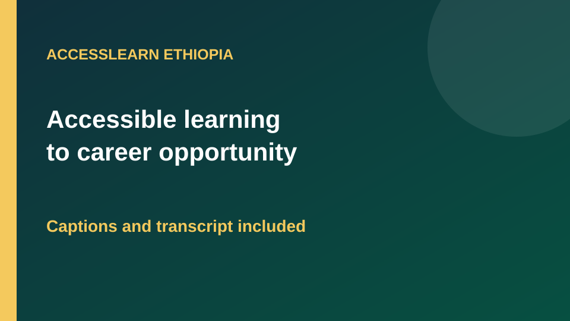
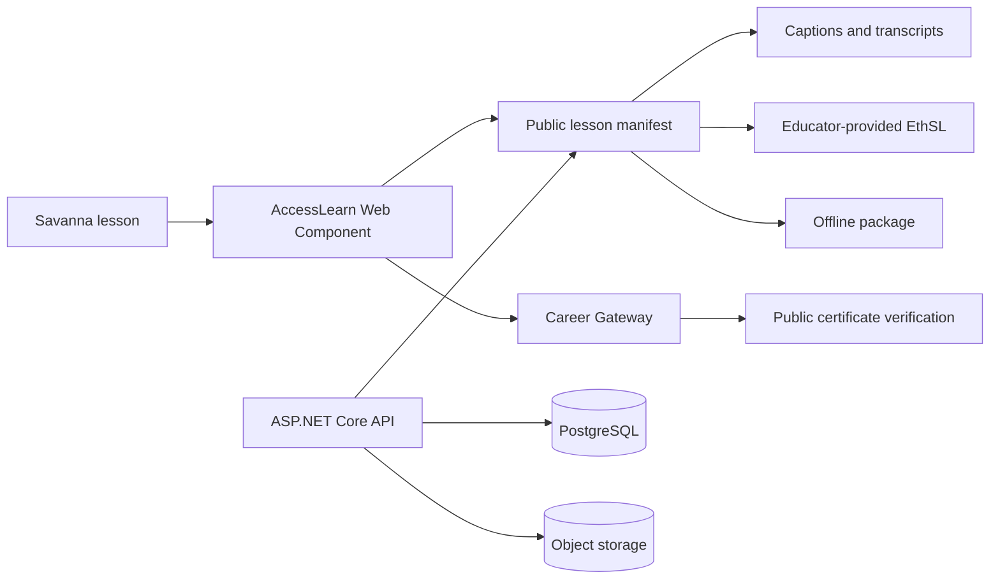

# AccessLearn Ethiopia

**Accessible learning media connected to career opportunity and verifiable proof.**

AccessLearn Ethiopia is a Digital Bridge Hackathon Track 2 project. It extends
the Savanna learning experience with a framework-neutral accessible media
player, educator-managed Amharic and Ethiopian Sign Language resources,
portable offline lessons, a Career Gateway, and public certificate
verification.

## Demo Recording

[](docs/recording.mp4)

**[Watch the full MP4 demo](docs/recording.mp4)** (17.2 MB)

The recording demonstrates the judge route from accessible learning media to
career discovery and certificate verification.

## Project Highlights

| Module | What it demonstrates |
|---|---|
| Accessible media player | Keyboard-first Web Component with captions, transcript search, progress events, persisted preferences, and 200% zoom reflow. |
| Amharic support | Independent English and Amharic caption/transcript selection with explicit draft and review status. |
| EthSL interpretation | Educator-supplied Ethiopian Sign Language window with enable/disable, drag, pointer or keyboard resize, minimize, maximize, and bounded positioning. |
| Offline learning | Downloadable ZIP containing local video, captions, transcript files, a manifest, and a standalone offline page. |
| Career Gateway | Responsive job cards, browser-spoken summaries, application safety guidance, and schema.org `JobPosting` JSON-LD. |
| Verifiable learning | Public employer-facing certificate page with an Open Badges 3.0-shaped JSON-LD achievement record. |
| Savanna integration | Additive player mount beneath the lesson banner without rebundling or replacing the starter Bootstrap assets. |

## Judge Route

The static showcase is the fastest way to evaluate the complete experience:

1. Watch the captioned sample lesson and open its transcript.
2. Switch to the Amharic draft and exercise the EthSL window controls.
3. Download the portable offline lesson package.
4. Continue into accessible career opportunities.
5. Verify the learner's public certificate.

The bundled sample runs without Docker, PostgreSQL, object storage, or the .NET
API.

## Clone And Run Locally

### Prerequisites

- [Git](https://git-scm.com/)
- Node.js `24.21.x`
- npm `11.x`
- Google Chrome or Chromium

### 1. Clone the repository

```bash
git clone https://github.com/ermi-e3/accessibility.git
cd accessibility
```

To preview the open integration branch before it is merged into `main`:

```bash
git switch integration
```

### 2. Install dependencies

```bash
npm install
```

### 3. Start the judge showcase

```bash
npm run serve:fixtures
```

Open:

```text
http://127.0.0.1:4173/
```

If that port is already occupied by another service, the fixture server tries
the next available port and prints the exact URL. Starting the command twice is
safe; it detects an existing AccessLearn fixture server instead of failing.

### 4. Stop the server

Press `Ctrl+C` in the terminal running the server.

## Useful Commands

| Command | Purpose |
|---|---|
| `npm run serve:fixtures` | Serve the Savanna judge showcase locally. |
| `npm run build` | Type-check and build the player, then sync its bundle into the showcase. |
| `npm run demo:prepare` | Rebuild the player and regenerate the rights-safe sample video, captions, transcripts, and offline ZIP. |
| `npm test` | Run Track 2 contracts and structured-data tests. |
| `npm run test:e2e` | Run Playwright, axe, speech-control, EthSL keyboard, reflow, completion, and download tests. |
| `dotnet test accessibility.slnx` | Run the ASP.NET Core and domain test suite. |

## Full Backend Development

The judge showcase is intentionally self-contained. Backend processing and
educator APIs additionally require:

- .NET SDK `10.0.401`
- Docker Desktop
- PostgreSQL and MinIO from `compose.yaml`
- Runtime and initialization values based on `.env.example`,
  `.env.initialize.example`, and `.env.runtime.example`

Start the local infrastructure with:

```bash
docker compose up -d
```

Trust the ASP.NET development certificate and run the API after loading the
required environment values:

```bash
dotnet dev-certs https --trust
dotnet run --project src/accessibility.Api --launch-profile https
```

The OpenAPI document is available from the running API at:

```text
https://localhost:7121/openapi/v1.json
```

## Educator Accessibility Workflow

AccessLearn does not claim automated sign-language generation. Educators upload
a rights-cleared, human-recorded EthSL interpretation and explicitly mark it
reviewed:

```text
POST /api/v1/lessons/{lessonId}/assets
  ?role=signLanguage
  &language=eth
  &reviewed=true
  &accessibilityMode=human-recorded
```

Use `multipart/form-data` for the MP4 or WebM file. Publishing the lesson adds
the approved media to the public player manifest.

Amharic transcript drafts can be created or imported through:

```text
POST /api/v1/lessons/{lessonId}/transcripts
POST /api/v1/lessons/{lessonId}/transcripts/import?language=am&format=WebVtt
```

Educators review and approve the transcript before publishing it. The included
Amharic sample is deliberately labelled as an unreviewed draft.

## Architecture



## Accessibility And Content Provenance

- English sample captions match the rights-safe narration source.
- The Amharic sample is a demonstration draft and requires fluent review.
- The sample sign window demonstrates controls only; it is not presented as an
  EthSL interpretation recording.
- Production publication accepts educator-supplied, human-recorded and reviewed
  `eth` media.
- Machine-generated captions remain drafts until an educator approves them.
- Career listings and the sample certificate are demonstration data.

## Validation Status

Current local validation:

- Contract tests: `8 passed`
- Browser and accessibility tests: `5 passed`
- .NET tests: `36 passed`, `14` environment-dependent integration tests skipped
- Player bundle: approximately `15.52 KB` gzip
- Pull request: [#6 - Integrate accessible learning showcase and career gateway](https://github.com/ermi-e3/accessibility/pull/6)

## Repository Structure

```text
Savanna-static-pages/       Judge showcase, sample media and offline package
src/accessibility.Api/      ASP.NET Core API and management endpoints
src/accessibility.Player/   Framework-neutral accessible media player
src/accessibility.*/        Domain, application and infrastructure layers
tests/                      .NET, contract and Playwright tests
scripts/                    Fixture server, media generation and import tools
sample-content/             Rights-safe narration and translation source data
docs/                       Demo recording, architecture and build evidence
tools/                      Backend provisioning and player helpers
```

## Project Scope

This repository is a hackathon prototype designed to demonstrate an accessible
learning-to-employment pathway. Production deployment still requires reviewed
employer feeds, fluent Amharic review, commissioned EthSL interpretation,
issuer-controlled credential signing, and operational security review.
