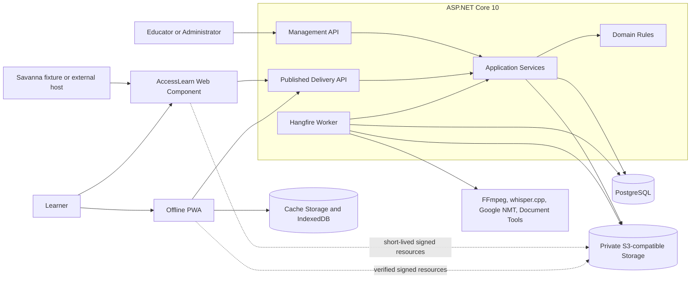

# AccessLearn Ethiopia

<p align="center">
  
</p>

> **One reviewed educational source becomes an accessible, bilingual, embeddable, and bandwidth-aware lesson without replacing the institution's existing platform.**

AccessLearn Ethiopia is an accessibility preparation and delivery layer for educational platforms. It combines reviewed captions and transcripts, Amharic support, human-recorded Ethiopian Sign Language, described audio, accessible documents, an embeddable media player, and text/audio-first offline learning behind one immutable lesson-publication contract.

The system is designed for educators, learners, administrators, and platform developers. It augments an existing LMS rather than replacing course navigation, identity, or institutional workflows.


## Table of Contents

- [Project Overview](#project-overview)
- [Problem Statement](#problem-statement)
- [Proposed Solution](#proposed-solution)
- [Key Features](#key-features)
- [Project Walkthrough](#project-walkthrough)
- [Technology Stack](#technology-stack)
- [Application Architecture](#application-architecture)
- [Getting Started](#getting-started)
- [Environment Variables](#environment-variables)
- [User Roles and Workflows](#user-roles-and-workflows)
- [Project Structure](#project-structure)
- [API Documentation](#api-documentation)
- [Accessibility and User Experience](#accessibility-and-user-experience)
- [Troubleshooting](#troubleshooting)
- [Deployment](#deployment)
- [Contributing](#contributing)
- [License](#license)
- [Acknowledgements](#acknowledgements)

## Project Overview

Educational content is often inaccessible in more than one way. A learner may need captions, language support, semantic document structure, described visual information, sign-language interpretation, keyboard controls, or a smaller offline format. A platform may also be technically accessible while remaining unusable over slow, intermittent, or expensive mobile connectivity.

AccessLearn addresses these barriers as a modular accessibility layer:

- Educators upload content once and review machine-assisted outputs.
- Generated transcripts and translations remain Draft until explicitly approved.
- A published lesson is an immutable snapshot of reviewed resources.
- Learners choose the modality that works for them online or offline.
- Existing platforms embed the same framework-neutral player through a script and lesson ID.
- Technical teams retain replaceable identity, storage, transcription, translation, document, and deployment adapters.

The core product flow is:

```text
Upload -> process -> human review -> publish -> embed or download
```

## Problem Statement

### Educational accessibility barriers

Ordinary educational videos and documents frequently omit:

- Captions and meaningful non-speech audio cues
- Searchable synchronized transcripts
- Descriptions of important visual information
- Human sign-language interpretation
- Semantic headings, lists, tables, links, reading order, and image alternatives
- Keyboard and screen-reader-compatible controls

These omissions exclude Deaf, hard-of-hearing, blind, visually impaired, keyboard-only, and screen-reader users from the same learning experience.

### Connectivity and device barriers

Video-first delivery also creates an economic and technical barrier. Large media performs poorly on low-cost Android devices, intermittent 3G connections, and expensive mobile data. A learner should be able to continue through compressed audio, text, captions, and semantic documents after the network disappears.

### Adoption barriers

Institutions already operate an LMS and cannot realistically migrate every course to a replacement platform. An accessibility solution must therefore integrate with the existing experience, preserve host navigation and identity, and expose stable APIs instead of demanding a frontend rewrite.

## Proposed Solution

AccessLearn turns one educational source into a reviewed, versioned set of accessibility resources. Its modules share the same ownership, review, publication, storage, and delivery infrastructure.

### Accessible media delivery

The `<accesslearn-player>` Web Component uses native HTML5 media and Shadow DOM to provide semantic playback controls, English and Amharic captions, searchable transcripts, a synchronized Ethiopian Sign Language window, and a synchronized full-mix described-audio track. It can run in AccessLearn, a neutral website, or an external host without taking a dependency on the host's framework or CSS.

### Human-in-the-loop processing

Uploads are streamed through bounded quarantine, hashed, signature-checked, inspected with ffprobe, and stored privately. Durable Hangfire jobs use FFmpeg for renditions, local `whisper.cpp` for timestamped speech recognition, and an optional Google Cloud Translation adapter for English/Amharic Draft translations. Educators correct text and timing before approval. Machine output is never auto-published.

### Immutable publication

Publication creates a checksummed snapshot that pins exact media, caption, transcript, sign-language, described-audio, document, and low-bandwidth references. New work can continue without breaking the currently published lesson. Public APIs return approved resources only and issue short-lived signed object-storage URLs.

### Offline learning

The lightweight profile packages compressed audio, reviewed captions, plain-text transcripts, validated semantic HTML documents, a local shell, hashes, and a portable ZIP. The PWA verifies each asset, resumes missing files, activates a package atomically, preserves the previous ready revision during an update, and serves final caches when the network is unavailable.

### Accessible documents

The document pipeline is designed to normalize structured DOCX content into one reviewed semantic model, report structure and image-description issues, render sanitized semantic HTML, and generate a tagged PDF/UA candidate. A PDF is labelled accessible only after automated and manual validation. Arbitrary scanned-PDF remediation and automated sign-language generation are intentionally outside the scope.

### Integration without LMS replacement

Anonymous delivery APIs, scoped server-side API keys, OpenAPI 3.1, and a versioned framework-neutral bundle allow an institution to add accessibility around its existing courses. The supplied Savanna material is used as a hostile-style integration fixture; the actual Rails/React Savanna source, identity, database, and deployment contracts are not present in this repository.

## Key Features

### Accessible Player

- Semantic play, pause, seek, volume, mute, playback-rate, and fullscreen controls
- Keyboard shortcuts with visible focus and no focus trap
- English and Amharic WebVTT captions
- Persistent caption size, foreground, background, and opacity settings
- Searchable synchronized transcript with seek-by-segment
- Human-recorded Ethiopian Sign Language window with pointer and keyboard movement
- Resizable and minimizable sign-language presentation
- Synchronized full-mix described audio
- Responsive layout, high-contrast support, reduced motion, and graceful resource failures
- Public methods, state retrieval, teardown, and lifecycle CustomEvents

### Processing and Review

- Streaming media, caption, transcript, sign, described-audio, and DOCX ingestion
- Extension, MIME, file-signature, checksum, size, and content validation
- FFmpeg speech extraction, low-bandwidth Opus audio, and poster generation
- Local multilingual timestamped transcription through `whisper.cpp`
- Ordered English/Amharic Draft translation through Google Cloud Translation v3
- WebVTT and SRT import
- Optimistic-concurrency editing and explicit correction revisions
- Deterministic WebVTT, SRT, and plain-text export
- Reviewed sign-language and described-audio association
- Durable progress, attempt history, cancellation, retries, leases, and idempotency
- Recursive staleness when source media or reviewed text changes

### Offline Learning

- One immutable lightweight package per publication/profile
- Compressed audio, captions, transcripts, semantic HTML, hashes, and portable ZIP
- Exact package contents and byte size before download
- Storage-quota check before activation
- Per-asset SHA-256 verification
- Interrupted-download resume from the next missing asset
- Temporary and final cache separation
- Transaction-complete atomic activation
- Old revision preservation until the replacement is ready
- Package-specific signed-URL refresh
- Network-off audio, visible captions, transcript text, and sandboxed documents
- Update detection, removal, retention cleanup, and package history

### Accessible Documents

- Structured DOCX ingestion with ZIP expansion and relationship protections
- Heading, paragraph, list, table, link, figure, image, and language normalization
- Reading-order and structural issue reporting
- Reviewed alt text or explicit decorative-image state
- Sanitized semantic HTML
- Ethiopic-capable font strategy
- Tagged PDF/UA candidate generation
- Stored PDF validation report and truthful output labels
- Optional BRF as a separate bonus capability

### Integration and Security

- Framework-neutral IIFE player bundle with stable and hashed filenames
- Declarative script-tag and programmatic mounting
- Multiple style-isolated player instances
- Cookie authentication for educators and administrators
- HMAC-hashed, scoped server-to-server API keys
- Private-by-default lessons and object storage
- Antiforgery, owner filtering, rate limiting, CORS, and Problem Details
- PostgreSQL-backed Identity, metadata, revision, attempt, and package history
- Administrator-only Hangfire dashboard

## Project Walkthrough

Watch the video below for a demonstration of AccessLearn Ethiopia, its accessibility workflow, and the learner experience.

[](https://www.youtube.com/watch?v=euHyRqrEOzI)

**Watch the full walkthrough:** [AccessLearn Ethiopia Project Demonstration](https://www.youtube.com/watch?v=euHyRqrEOzI)

## Technology Stack

### Backend

| Technology | Version | Purpose |
|---|---:|---|
| .NET SDK | 10.0.401 | Exact pinned SDK; roll-forward is disabled |
| ASP.NET Core | 10 | HTTP API, Identity cookies, Razor/static hosting, localization, health and OpenAPI |
| C# | 14.0 | Domain, application, infrastructure and API implementation |
| EF Core | 10.0.12 | Relational persistence and migrations |
| Npgsql EF provider | 10.0.3 | PostgreSQL integration |
| ASP.NET Core Identity EF | 10.0.12 | Users, roles, password and cookie authentication |
| Hangfire | 1.8.25 | Durable background processing |
| Hangfire PostgreSQL | 1.21.1 | Queue and dashboard persistence |
| AWS SDK for S3 | 4.1.0 | S3-compatible object storage and signed URLs |
| Google Cloud Translate v3 | 3.11.0 | Optional English/Amharic NMT Draft translation |

### Frontend

| Technology | Version | Purpose |
|---|---:|---|
| TypeScript | 7.0.2 | Strict Web Component and player source |
| Vite | 8.3.8 | IIFE SDK build and minification |
| Playwright | 1.65.1 | Browser/PWA test definitions |
| Web Components and Shadow DOM | Browser platform | Framework-neutral, style-isolated player |
| Service Worker, Cache Storage, IndexedDB | Browser platform | Offline shell, verified content and package metadata |

Vite 8 requires Node.js `20.19+` or `22.12+`. The repository does not include a Node version-manager file.

### Data and Processing

| Technology | Purpose |
|---|---|
| PostgreSQL 18 | Identity, lessons, transcript segments, publications, jobs and packages |
| MinIO | Local S3-compatible private object storage |
| FFmpeg and ffprobe | Content inspection, speech extraction, Opus audio and posters |
| whisper.cpp | Local multilingual timestamped speech recognition |
| Google Cloud Translation | Optional cloud English/Amharic Draft translation |
| Open XML SDK | Approved document-normalization dependency |
| WeasyPrint and veraPDF | Approved document PDF/UA generation and validation tooling |

Open XML, WeasyPrint and veraPDF belong to the document-processing design. They are not installed dependencies in the current repository snapshot.

## Application Architecture

AccessLearn is an ASP.NET Core modular monolith with Clean Architecture-style boundaries.



### Responsibilities

| Component | Responsibility |
|---|---|
| Domain | Ownership, states, review, staleness, revision and publication invariants |
| Application | Feature contracts and provider-independent orchestration |
| Infrastructure | EF Core, Identity, S3, Hangfire, FFmpeg, Whisper, translation, player publication and offline packages |
| API | Versioned controllers, auth policies, localization, Problem Details, health and static applications |
| Player | Public-manifest consumption and learner accessibility controls |
| Offline PWA | Verified downloads, atomic local packages and network-off delivery |

## Getting Started

The repository is currently Windows-oriented because its setup scripts and configured media tools use PowerShell and Windows `.exe` paths. Linux or WSL can run the .NET application, but FFmpeg, ffprobe and whisper paths must be replaced with compatible native binaries.

### 1. Prerequisites

Install:

- Git
- PowerShell 7+
- .NET SDK **10.0.401** exactly
- Node.js **20.19+** or **22.12+** and npm
- Docker Desktop with Docker Compose
- A trusted ASP.NET Core HTTPS development certificate
- PostgreSQL `psql` only when provisioning an external database manually

Trust the development certificate:

```powershell
dotnet dev-certs https --trust
```

Media-processing dependencies:

- FFmpeg and ffprobe are required for media upload inspection, demo-media generation and processing.
- whisper.cpp CLI and multilingual model
- Google Cloud project, billing and service-account credentials for automated translation

Install a trusted FFmpeg/ffprobe distribution before starting the API. The current `tools/setup-ffprobe.ps1` asset URL returns 404 and is not a working quick-start path. Record the absolute executable paths for `MediaProbe__ExecutablePath` and `MediaProcessing__FfmpegPath` in both initialization and runtime configuration.

### 2. Clone the Repository

```powershell
git clone https://github.com/ermi-e3/accessibility.git
cd accessibility
```

### 3. Restore .NET Dependencies

```powershell
dotnet restore .\accessibility.slnx --locked-mode
```

The exact SDK is selected by `global.json`. A different patch will not roll forward.

### 4. Build the Player SDK

```powershell
pwsh -File .\tools\build-player.ps1
```

This performs `npm ci`, TypeScript checking and a production Vite build. It creates:

```text
src/accessibility.Api/wwwroot/sdk/v1/accesslearn-player.min.js
src/accessibility.Api/wwwroot/sdk/v1/accesslearn-player.<hash>.js
```

The generated SDK directory is intentionally ignored by Git and does not exist in a fresh clone until built.

### 5. Configure PostgreSQL and MinIO

Create the ignored Compose environment file:

```powershell
Copy-Item .\.env.example .\.env
```

Edit `.env` and replace every placeholder. Do not use the example passwords unchanged.

Start the dependency services:

```powershell
docker compose --env-file .env up -d
docker compose --env-file .env ps --all
```

Compose starts PostgreSQL, MinIO and a one-shot MinIO initializer. It does **not** start the ASP.NET API.

Do not continue until `postgres` and `minio` report healthy and `minio-init` has exited successfully with code 0.

Local service ports:

| Service | URL |
|---|---|
| PostgreSQL | `127.0.0.1:5432` |
| MinIO S3 API | `http://localhost:9000` |
| MinIO console | `http://localhost:9001` |

The PostgreSQL initialization script runs only on an empty named volume. Changing role passwords in `.env` does not re-run that script for an existing volume.

### 6. Configure One-Time Initialization

The example dotenv files are documentation only. ASP.NET does not load them automatically, and connection strings contain semicolons, so do not shell-source them directly.

Create an initialization file outside the repository:

```powershell
Copy-Item .\.env.initialize.example "$HOME\accesslearn.initialize.env"
```

Edit every placeholder. Use a bootstrap password that includes at least 12 characters, uppercase, lowercase, a digit and a symbol.

Load the file into the current PowerShell process:

```powershell
Get-Content "$HOME\accesslearn.initialize.env" |
  Where-Object { $_ -and -not $_.StartsWith('#') } |
  ForEach-Object {
    $name, $value = $_ -split '=', 2
    [Environment]::SetEnvironmentVariable($name, $value, 'Process')
  }
```

For initialization, ensure:

```text
ConnectionStrings__Hangfire=<Hangfire owner connection>
Hangfire__PrepareSchemaIfNecessary=true
```

Then run:

```powershell
dotnet run --project .\src\accessibility.Api\accessibility.Api.csproj `
  --launch-profile https -- --initialize
```

Initialization applies EF migrations, creates Hangfire tables, creates Identity roles, optionally creates the bootstrap administrator, creates/checks the object-storage bucket and, when `ObjectStorage__ProvisionBucketCors=true`, applies bucket CORS. Local Compose configures MinIO CORS separately. The initializer then exits without starting HTTP.

### 7. Configure Normal Runtime

Close the initialization terminal so privileged environment variables are not retained. Delete `$HOME\accesslearn.initialize.env`, or protect it using operating-system file permissions if it must be retained for recovery. Then open a new PowerShell terminal for restricted runtime configuration.

```powershell
Copy-Item .\.env.runtime.example "$HOME\accesslearn.runtime.env"
```

Edit the values. The runtime Hangfire connection must use the restricted runtime role:

```text
ConnectionStrings__Hangfire=<Hangfire runtime connection>
Hangfire__PrepareSchemaIfNecessary=false
```

Protect `$HOME\accesslearn.runtime.env` using operating-system file permissions because it contains database, storage and API-key secrets.

Load the file using the same PowerShell parser from the previous section.

Before starting the API, confirm that both paths below point to real executables. Passing `-FfmpegPath` to the demo seeder does not configure the API's upload inspection.

```text
MediaProbe__ExecutablePath=C:\path\to\ffprobe.exe
MediaProcessing__FfmpegPath=C:\path\to\ffmpeg.exe
```

### 8. Start the API

```powershell
dotnet run --project .\src\accessibility.Api\accessibility.Api.csproj `
  --launch-profile https
```

Keep this terminal running. Hangfire processing workers run inside the API process.

### 9. Open the Application

| Area | URL |
|---|---|
| HTTP listener (redirects to HTTPS) | `http://localhost:5052` |
| OpenAPI JSON | `https://localhost:7121/openapi/v1.json` |
| Liveness | `https://localhost:7121/health/live` |
| Readiness | `https://localhost:7121/health/ready` |
| Player demo | `https://localhost:7121/player-demo/?lesson=<LESSON_ID>&locale=en` |
| Amharic player | `https://localhost:7121/player-demo/?lesson=<LESSON_ID>&locale=am` |
| Offline PWA | `https://localhost:7121/offline/?lesson=<LESSON_ID>&locale=en` |
| Hangfire dashboard | `https://localhost:7121/admin/jobs` |
| SDK stable URL | `https://localhost:7121/sdk/v1/accesslearn-player.min.js` |

`/admin/jobs` requires an authenticated Administrator cookie. The repository does not currently include a browser login page.

### 10. Create a Demo Lesson

Install a trusted FFmpeg/ffprobe distribution and pass its `ffmpeg.exe` path explicitly. The repository's current `tools/setup-ffprobe.ps1` asset URL returns 404 and should not be relied on until updated.

With the API running:

```powershell
pwsh -File .\tools\seed-player-demo.ps1 `
  -Email "<BOOTSTRAP_ADMIN_EMAIL>" `
  -Password "<BOOTSTRAP_ADMIN_PASSWORD>" `
  -FfmpegPath "C:\path\to\ffmpeg.exe"
```

The script creates a rights-safe synthetic WebM, creates and approves English/Amharic transcripts, publishes the lesson, and prints player-demo URLs.

Optional professional resources:

```powershell
pwsh -File .\tools\seed-player-demo.ps1 `
  -Email "<BOOTSTRAP_ADMIN_EMAIL>" `
  -Password "<BOOTSTRAP_ADMIN_PASSWORD>" `
  -FfmpegPath "C:\path\to\ffmpeg.exe" `
  -SignVideoPath "C:\media\sign.webm" `
  -AudioDescriptionPath "C:\media\described-audio.wav"
```

The optional sign/described-audio files must match the generated six-second lesson duration.

The seed script does not start a processing job or create an offline package. Use the processing and offline-package APIs for those workflows.

### 11. Explore Processing and Offline Learning

Use an HTTPS-capable HTTP client that retains cookies. Obtain an antiforgery cookie/token from `/api/v1/auth/antiforgery`, log in, and send `X-CSRF-TOKEN` on each cookie-authenticated mutation.

1. Call `GET /api/v1/lessons/{lessonId}` and copy the active primary asset ID and current lesson ETag/version.
2. Call `POST /api/v1/lessons/{lessonId}/processing-jobs` with the primary asset ID. Use `targetLanguages: ["en"]` when Google Translation is disabled.

```json
{
  "sourceAssetId": "<PRIMARY_ASSET_GUID>",
  "targetLanguages": ["en"]
}
```

3. Poll `GET /api/v1/processing-jobs/{jobId}` until it reports success. This creates the low-bandwidth audio rendition.
4. Reload the lesson and call `POST /api/v1/lessons/{lessonId}/publish` with the current `If-Match` value so the publication pins the offline audio.
5. Call `POST /api/v1/lessons/{lessonId}/offline-packages`.
6. Poll `GET /api/v1/offline-packages/{packageId}` until it reports Ready.
7. Open `https://localhost:7121/offline/?lesson={lessonId}&locale=en`, download the package, then disable the network and reload.

The worker requires valid FFmpeg, ffprobe and whisper.cpp/model paths. Use `tools/setup-whisper.ps1` for the pinned whisper.cpp/model setup. The Processing and Offline endpoint tables below show the exact routes and required access.

## Environment Variables

### Compose Variables

Copy `.env.example` to the ignored `.env` file.

| Variable | Purpose | Required | Safe example |
|---|---|---:|---|
| `POSTGRES_DB` | PostgreSQL database name | Yes | `accesslearn` |
| `POSTGRES_ADMIN_USER` | PostgreSQL container bootstrap superuser | Yes | `postgres` |
| `POSTGRES_ADMIN_PASSWORD` | PostgreSQL container superuser password | Yes | `<strong-random-password>` |
| `ACCESSLEARN_MIGRATION_USER` | EF migration/schema owner | Yes | `accesslearn_migrator` |
| `ACCESSLEARN_MIGRATION_PASSWORD` | Migration-role password | Yes | `<strong-random-password>` |
| `ACCESSLEARN_DB_USER` | Least-privilege application role | Yes | `accesslearn_app` |
| `ACCESSLEARN_DB_PASSWORD` | Application-role password | Yes | `<strong-random-password>` |
| `ACCESSLEARN_HANGFIRE_OWNER_USER` | Hangfire schema owner | Yes | `accesslearn_hangfire_owner` |
| `ACCESSLEARN_HANGFIRE_OWNER_PASSWORD` | Hangfire owner password | Yes | `<strong-random-password>` |
| `ACCESSLEARN_HANGFIRE_USER` | Hangfire runtime role | Yes | `accesslearn_hangfire` |
| `ACCESSLEARN_HANGFIRE_PASSWORD` | Hangfire runtime password | Yes | `<strong-random-password>` |
| `MINIO_ROOT_USER` | MinIO administrator | Yes | `accesslearn_admin` |
| `MINIO_ROOT_PASSWORD` | MinIO administrator password | Yes | `<strong-random-password>` |
| `MINIO_APP_USER` | Restricted object-storage identity | Yes | `accesslearn_app` |
| `MINIO_APP_PASSWORD` | Restricted storage password | Yes | `<strong-random-password>` |
| `MINIO_BUCKET` | Private object bucket | Yes | `accesslearn` |
| `MINIO_CORS_ALLOWED_ORIGINS` | Browser origins permitted for signed resources | Yes | `https://localhost:7121` |

### Application Variables

Use process environment variables, a secure production secret store, or `dotnet user-secrets` for local Development. Double underscores represent nested ASP.NET configuration keys.

| Variable | Purpose | Init | Runtime | Safe example |
|---|---|---:|---:|---|
| `ConnectionStrings__Database` | Least-privilege application DB connection | Yes | Yes | `Host=localhost;...;Username=accesslearn_app;Password=<password>` |
| `ConnectionStrings__MigrationDatabase` | Migration-owner connection | Yes | No | `Host=localhost;...;Username=accesslearn_migrator;Password=<password>` |
| `ConnectionStrings__Hangfire` | Hangfire owner/runtime connection | Yes | Yes | See initialization/runtime sections |
| `Hangfire__PrepareSchemaIfNecessary` | Allow one-time Hangfire DDL | `true` | `false` | `false` |
| `ObjectStorage__ServiceUrl` | API-reachable S3 endpoint | Yes | Yes | `http://localhost:9000` |
| `ObjectStorage__PublicServiceUrl` | Browser-reachable signing endpoint | Yes | Yes | `http://localhost:9000` |
| `ObjectStorage__AccessKey` | Restricted S3 application user | Yes | Yes | `accesslearn_app` |
| `ObjectStorage__SecretKey` | Restricted S3 secret | Yes | Yes | `<strong-random-password>` |
| `ObjectStorage__BucketName` | Private bucket name | Yes | Yes | `accesslearn` |
| `ObjectStorage__ProvisionBucketCors` | Apply bucket CORS during initialization; local Compose configures MinIO CORS separately | Optional | Optional | `false` |
| `ObjectStorage__CorsAllowedOrigins__0` | First allowed browser origin when bucket CORS provisioning is enabled | Conditional | Conditional | `https://localhost:7121` |
| `ObjectStorageProvisioning__AccessKey` | S3 provisioning administrator | Yes | No | `accesslearn_admin` |
| `ObjectStorageProvisioning__SecretKey` | S3 provisioning secret | Yes | No | `<strong-random-password>` |
| `ApiKeyAuthentication__Pepper` | HMAC pepper for integration API keys | Yes | Yes | `<32+-character-random-secret>` |
| `MediaProbe__ExecutablePath` | ffprobe path | Yes | Yes | `C:\tools\ffprobe.exe` |
| `MediaProcessing__FfmpegPath` | FFmpeg path | Yes | Yes | `C:\tools\ffmpeg.exe` |
| `Whisper__ExecutablePath` | whisper.cpp CLI path | Yes | Yes | `.tools\whisper\bin\whisper-cli.exe` |
| `Whisper__ModelPath` | Multilingual model path | Yes | Yes | `.tools\whisper\models\ggml-small-q5_1.bin` |
| `GoogleTranslation__Enabled` | Enable cloud translation | Yes | Yes | `false` |
| `GoogleTranslation__ProjectId` | Google Cloud project | Conditional | Conditional | `<google-project-id>` |
| `GoogleTranslation__Location` | Translation API location | Conditional | Conditional | `global` |
| `GOOGLE_APPLICATION_CREDENTIALS` | Google ADC service-account JSON path | Conditional | Conditional | `C:\secrets\google.json` |
| `PlayerDelivery__PublicApiBaseUrl` | Browser-reachable AccessLearn URL | Yes | Yes | `https://localhost:7121` |
| `BootstrapAdmin__Email` | Optional first administrator email | Optional | No | `judge@example.test` |
| `BootstrapAdmin__DisplayName` | Optional first administrator name | Optional | No | `Hackathon Judge` |
| `BootstrapAdmin__Password` | Optional first administrator password | Optional | No | `<valid-strong-password>` |

All three bootstrap values must be supplied together or omitted together.

### Local User Secrets Example

```powershell
dotnet user-secrets set "ConnectionStrings:Database" "<connection-string>" `
  --project .\src\accessibility.Api\accessibility.Api.csproj

dotnet user-secrets set "ApiKeyAuthentication:Pepper" "<32+-character-secret>" `
  --project .\src\accessibility.Api\accessibility.Api.csproj
```

User secrets load in Development only. They are not a production secret-management system.

## User Roles and Workflows

### Learner

1. Open a public embedded or hosted lesson.
2. Navigate through touch, keyboard, or screen reader controls.
3. Select English/Amharic captions, transcript, sign language, or described audio.
4. Search the transcript and seek to a segment.
5. Open the hosted offline library when connectivity is available.
6. Download and verify a lightweight package.
7. Reload and continue after the network is disabled.

Public learners do not require an account.

### Educator

1. Authenticate through the antiforgery/login API flow.
2. Create a lesson and stream source/accessibility resources.
3. Start durable processing or import reviewed caption files.
4. Correct text and timing through versioned transcript APIs.
5. Approve transcript revisions and generated caption artifacts.
6. Attach human-reviewed sign and described-audio resources.
7. Publish an immutable revision.
8. Generate its lightweight offline package.

### Administrator

Administrators can act across all lessons, inspect Hangfire jobs, manage provider configuration and perform operational recovery. The repository does not currently expose a browser account-management page.

### External Platform Developer

Public embedding uses no browser secret. Trusted management calls use a scoped server-side API key. The repository currently has internal API-key generation logic but no provisioning endpoint or CLI.

## Project Structure

```text
accessibility/
|-- accessibility.slnx
|-- compose.yaml
|-- global.json
|-- Directory.Build.props
|-- deploy/
|   `-- postgres/init/               # PostgreSQL roles and schemas
|-- src/
|   |-- accessibility.Domain/        # Entities, states and invariants
|   |-- accessibility.Application/   # Contracts, policies and ports
|   |-- accessibility.Infrastructure/# EF, Identity, S3, jobs and providers
|   |-- accessibility.Api/           # Controllers, composition, demos and PWA
|   `-- accessibility.Player/        # TypeScript Web Component and Playwright
|-- tests/
|   `-- Accessibility.Foundation.Tests/
|-- tools/                            # Build, setup, provisioning and demo scripts
`-- Savanna-static-pages/             # Frozen integration fixture, not app source
```

## API Documentation

The runtime OpenAPI 3.1 document is available at:

```text
https://localhost:7121/openapi/v1.json
```

There is no Swagger, Scalar, ReDoc, `/swagger`, or `/docs` UI in the repository.

Management routes accept either an authenticated Educator/Administrator cookie or a server-held API key with the listed scope. Cookie-authenticated mutations also require `X-CSRF-TOKEN`; API-key requests bypass cookie antiforgery. Management endpoints do not expose a cross-origin CORS policy. Anonymous public GET/HEAD endpoints and OpenAPI use non-credentialed public-read CORS; object-storage CORS is configured separately.

### Authentication

| Method | Route | Access |
|---|---|---|
| GET | `/api/v1/auth/antiforgery` | Anonymous |
| POST | `/api/v1/auth/login` | Anonymous plus antiforgery token |
| POST | `/api/v1/auth/logout` | Cookie plus antiforgery token |
| GET | `/api/v1/auth/me` | Authenticated cookie |

### Lessons and Resources

| Method | Route | Access |
|---|---|---|
| POST | `/api/v1/lessons` | Educator/Administrator or `lessons:write` |
| GET | `/api/v1/lessons` | Educator/Administrator or `lessons:read` |
| GET | `/api/v1/lessons/{lessonId}` | Educator/Administrator or `lessons:read` |
| POST | `/api/v1/lessons/{lessonId}/assets` | Educator/Administrator or `resources:write` |
| POST | `/api/v1/lessons/{lessonId}/documents` | Educator/Administrator or `resources:write` |

### Transcripts and Processing

| Method | Route | Access |
|---|---|---|
| GET | `/api/v1/lessons/{lessonId}/transcripts` | Educator/Administrator or `resources:read` |
| POST | `/api/v1/lessons/{lessonId}/transcripts` | Educator/Administrator or `resources:write` |
| POST | `/api/v1/lessons/{lessonId}/transcripts/import` | Educator/Administrator or `resources:write` |
| GET | `/api/v1/transcripts/{transcriptId}` | Educator/Administrator or `resources:read` |
| PUT | `/api/v1/transcripts/{transcriptId}` | Educator/Administrator or `resources:write` |
| POST | `/api/v1/transcripts/{transcriptId}/draft-revisions` | Educator/Administrator or `resources:write` |
| POST | `/api/v1/transcripts/{transcriptId}/approve` | Educator/Administrator or `resources:write` |
| GET | `/api/v1/transcripts/{transcriptId}/export` | Educator/Administrator or `resources:read` |
| POST | `/api/v1/lessons/{lessonId}/processing-jobs` | Educator/Administrator or `processing:write` |
| GET | `/api/v1/processing-jobs/{jobId}` | Educator/Administrator or `processing:read` |
| POST | `/api/v1/processing-jobs/{jobId}/retry` | Educator/Administrator or `processing:write` |
| POST | `/api/v1/processing-jobs/{jobId}/cancel` | Educator/Administrator or `processing:write` |
| POST | `/api/v1/lessons/{lessonId}/publish` | Educator/Administrator or `lessons:publish` |

### Public Player and Offline Delivery

| Method | Route | Access |
|---|---|---|
| GET | `/api/v1/public/lessons/{lessonId}/manifest` | Anonymous |
| GET | `/api/v1/public/lessons/{lessonId}/publications/{publicationId}/transcripts/{language}` | Anonymous |
| POST | `/api/v1/lessons/{lessonId}/offline-packages` | Educator/Administrator or `offline:write` |
| GET | `/api/v1/offline-packages/{packageId}` | Educator/Administrator or `offline:read` |
| POST | `/api/v1/offline-packages/{packageId}/retry` | Educator/Administrator or `offline:write` |
| GET | `/api/v1/public/lessons/{lessonId}/offline-manifest` | Anonymous |
| GET | `/api/v1/public/lessons/{lessonId}/offline-package.zip` | Anonymous |
| GET | `/api/v1/public/offline-packages/{packageId}/manifest` | Anonymous |
| GET | `/api/v1/public/offline-packages/{packageId}/package.zip` | Anonymous |

### Cookie Authentication Flow

1. Call `GET /api/v1/auth/antiforgery` and preserve the returned cookie.
2. Send the returned token in `X-CSRF-TOKEN`.
3. Call `POST /api/v1/auth/login` with email, password and optional remember-me value.
4. Continue to preserve the secure authentication cookie.

Use HTTPS. Both authentication and antiforgery cookies are Secure-only.

## Accessibility and User Experience

AccessLearn targets WCAG 2.2 AA and uses native semantics before ARIA.

- Every player action has a keyboard path.
- Focus is visible and restored after transcript/dialog interactions.
- Cue changes do not steal focus or announce every timestamp.
- Caption appearance preferences are stored locally.
- Amharic regions use `lang="am"`; Ethiopic text is left-to-right.
- Sign-language movement has pointer and keyboard alternatives.
- Missing optional resources do not disable the remaining lesson.
- Responsive layouts target 320 CSS pixels and 200% zoom.
- Forced-colors and reduced-motion preferences are respected.
- Offline packages expose visible captions, transcripts and sandboxed HTML documents.
- Generated text and translations remain Draft until human review.

Automated checks alone do not establish accessibility conformance. Manual NVDA/Chrome, TalkBack/Android Chrome, keyboard, zoom, caption-quality and PDF-validation evidence is still required before making a conformance claim.

## Troubleshooting

### The .NET SDK is rejected

Install .NET SDK `10.0.401`. `global.json` disables roll-forward.

### Player SDK returns 404

Build the player bundle:

```powershell
pwsh -File .\tools\build-player.ps1
```

`dotnet build` alone does not generate the ignored SDK directory.

### API exits during startup

Verify all startup-required settings:

- Database connection
- Hangfire connection
- S3 service/public URLs and credentials
- API-key pepper of at least 32 characters
- ffprobe, FFmpeg and Whisper paths
- Player public API base URL

### Readiness returns 503

Run the mandatory `--initialize` command, check pending migrations and verify the object-store bucket/app credentials.

### Browser login fails over HTTP

Use `https://localhost:7121`. Auth and antiforgery cookies are Secure-only.

### Bootstrap administrator creation fails

Use a password with at least 12 characters, uppercase, lowercase, a digit and a symbol. Supply email, display name and password together.

### PostgreSQL role password changes do not work

The Compose init script runs only for a new volume. Alter existing roles manually or recreate the development volume, which deletes its data.

### Hangfire reports schema permissions

Initialize once with the Hangfire owner connection and `Hangfire__PrepareSchemaIfNecessary=true`. Normal runtime must use the runtime connection and `false`.

### FFmpeg setup script returns 404

The currently pinned asset URL in `tools/setup-ffprobe.ps1` is unavailable. Install a trusted FFmpeg/ffprobe distribution manually and set `MediaProbe__ExecutablePath` and `MediaProcessing__FfmpegPath` explicitly.

### Google translation fails

Confirm billing, Translation API enablement, project ID and `GOOGLE_APPLICATION_CREDENTIALS`. Keep `GoogleTranslation__Enabled=false` when no credentials are available.

### Public media does not load

`ObjectStorage__PublicServiceUrl` must be reachable from the browser, and S3/MinIO CORS must allow the player origin and range requests.

### Offline package generation fails

The lesson must be published and have a ready low-bandwidth audio rendition. The player demo seed does not automatically run the processing or package-generation APIs.

### `/swagger`, `/docs` or `/` returns 404

The repository exposes `/openapi/v1.json`, explicit player/offline routes and APIs only. It does not contain Swagger UI or a root landing page.

### Docker problems

Compose contains dependencies only. It does not build or run the API. Ensure Docker Desktop is running; otherwise provision PostgreSQL and S3-compatible storage separately.

## Acknowledgements

AccessLearn builds on:

- ASP.NET Core, EF Core and Identity
- PostgreSQL and Npgsql
- Hangfire
- Amazon S3-compatible storage and MinIO
- FFmpeg and ffprobe
- whisper.cpp
- Google Cloud Translation
- TypeScript, Vite and Playwright
- Web Components, Service Workers, Cache Storage and IndexedDB
- Bootstrap/Popper assets present in the frozen Savanna fixture

The Savanna pages in this repository are static captures used to evaluate embedding and style isolation. They are not the live Savanna application source.
