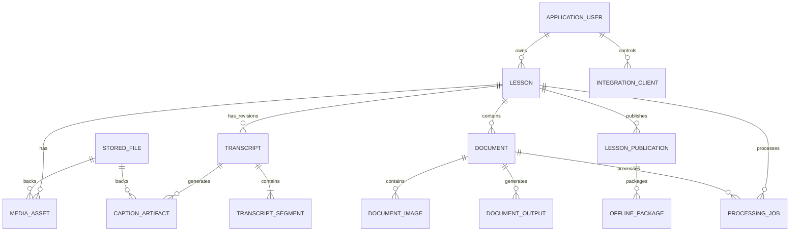
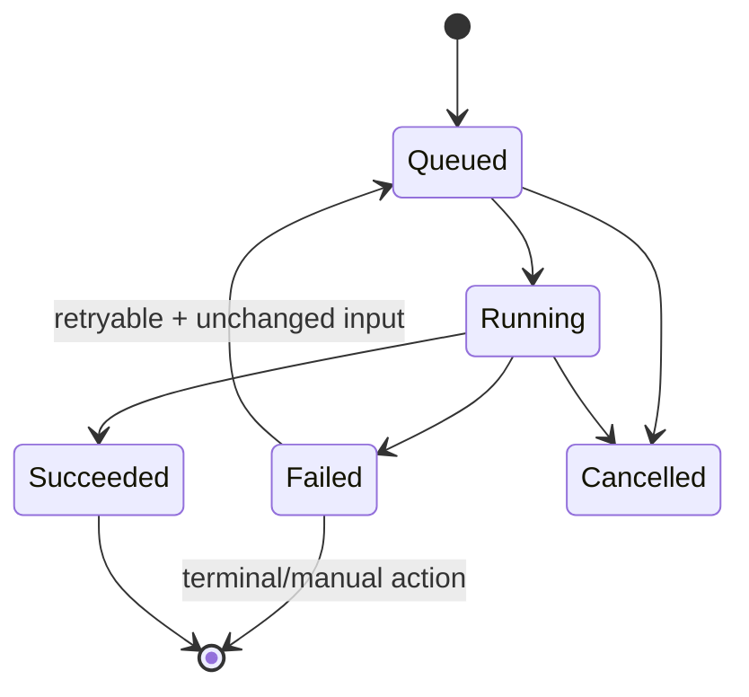
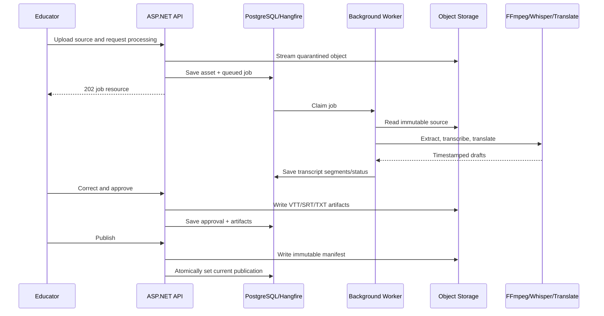
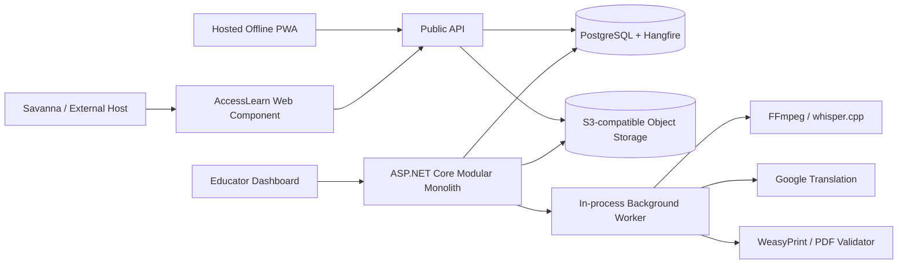
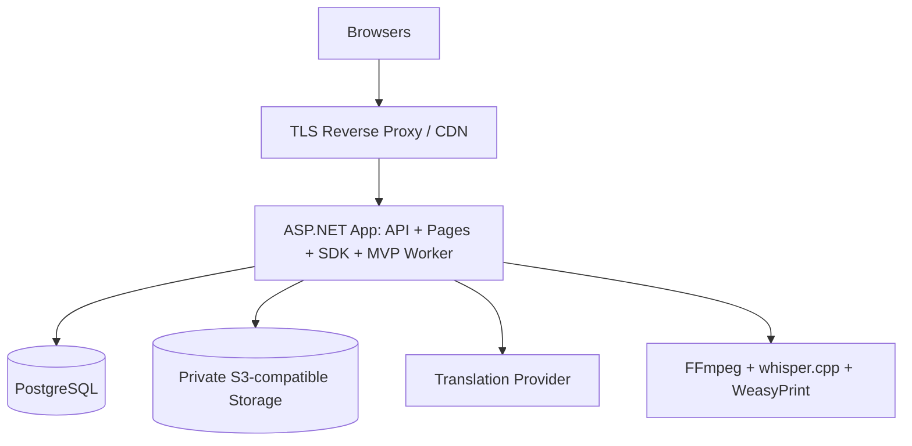

# AccessLearn Ethiopia: 48-Hour MVP Solution Blueprint

## Plan Status

This is an implementation-ready blueprint for the workspace as it exists on 2026-11-15. The frozen Savanna starter is imported and now carries an additive Track 2 integration; the live Savanna backend, identity, enrollment, and completion contracts remain outside this fixture boundary.

Track 2 now includes a bounded Career Gateway extension: static accessible job cards, user-triggered speech summaries, `JobPosting` JSON-LD, a public certificate registry prototype, and an Open Badges 3.0-shaped record. Live employer feeds, signed credential issuance, and revocation remain a later backend phase.

## 1. Starter Analysis and Decision Record

### Verified Repository State

| Area | Evidence | Planning consequence |
|---|---|---|
| Solution | `accessibility.slnx` contains API, Application, Domain, and Infrastructure projects. | Keep the clean-architecture boundaries and implement a modular monolith. |
| Runtime | All projects target .NET 10; `src/accessibility.Api/accessibility.Api.csproj` contains only `Microsoft.AspNetCore.OpenApi`. | Keep ASP.NET Core 10 and built-in OpenAPI 3.1 support. Pin the SDK before implementation. |
| API | `src/accessibility.Api/Program.cs` registers controllers and development OpenAPI only. The sole endpoint is Weather Forecast. | Remove template behavior and establish AccessLearn API conventions; no existing product convention needs preserving. |
| Domain/data | Domain, Application, and Infrastructure contain placeholders. There is no ORM, database, migration, auth, storage, queue, or job runner. | All data and business rules in this document are new, but fit the existing project boundaries. |
| Savanna material | `Savanna-static-pages/README.md` identifies the supplied pages as frozen HTML/CSS captures with no server and no application JavaScript. | Do not claim Savanna backend, database, identity, or deployment compatibility has been verified. |
| Savanna clues | Captures contain React markers, Rails-style CSRF/form markup, Bootstrap 5.3 assets, Video.js CSS, and expired development S3 URLs. | Treat Rails, React islands, Video.js, cookie auth, and S3 as clues only. The SDK must not depend on any of them. |
| Source control | The application scaffold, solution, requirements, and frozen pages are untracked in the current initial-commit repository. | First implementation action is to review and establish an intentional baseline; do not overwrite or silently omit current work. |
| Tests/deployment | No tests, CI, container definition, production config, health checks, or observability exist. | Add the minimum reproducible local/deployment and validation paths required for the demo. |

### Mandatory Savanna Preflight

Before merging AccessLearn into the real starter, obtain and inspect the actual Savanna source and documentation. Confirm its runtime versions, database and ORM, identity/session mechanism, content identifiers, object storage, asset pipeline, CSP/CORS, frontend mount points, deployment, and test conventions. If those findings conflict with this plan, preserve the player/public API contracts and adapt only the host integration, identity adapter, and storage adapter. Do not merge databases or duplicate Savanna users without an explicit mapping decision.

### Decided Architecture

| Decision | Choice | Reason |
|---|---|---|
| System shape | ASP.NET Core modular monolith | Matches the scaffold and avoids hackathon microservice overhead. |
| Player | Dependency-free TypeScript Web Component with Shadow DOM | Gives script-tag installation, host-style isolation, and framework independence. |
| Dashboard | Razor Pages plus small progressive-enhancement JavaScript and local Bootstrap 5.3 | Minimizes frontend infrastructure while matching visible Savanna conventions. |
| Metadata database | PostgreSQL with EF Core | Supports relational integrity, JSONB where justified, concurrency, and Hangfire storage. |
| Binary storage | One S3-compatible private object store through `IObjectStorage`; local S3-compatible service for development | Keeps large media out of the database and permits signed URLs and range requests. |
| Background work | Hangfire with PostgreSQL plus an AccessLearn `ProcessingJob` record | Durable jobs and retries without a separate service; the domain record remains provider-neutral. |
| Media | FFmpeg/ffprobe and local `whisper.cpp` multilingual model | Reproducible extraction/transcoding and draft transcription without uploading source media to a third party. |
| Amharic translation | Google Cloud Translation NMT behind `ITranslationProvider` | Officially supports `am`; preserve manual import/edit fallback and human review. |
| Documents | Open XML SDK -> normalized structure -> semantic HTML -> WeasyPrint PDF/UA candidate -> validator | Avoids pretending a visually formatted PDF is tagged; keeps one semantic source for HTML/PDF. |
| Offline | Hosted same-origin PWA using Service Worker, Cache Storage, and IndexedDB, plus a portable ZIP | A cross-origin embed script cannot register a service worker for the host origin. |
| Authentication | ASP.NET Core Identity cookie for the provisional dashboard; scoped API keys for server integrations; anonymous published-player endpoints | Provides a secure standalone MVP while leaving a clear identity adapter for real Savanna. |
| Accessibility target | WCAG 2.2 AA plus manual assistive-technology checks | Covers keyboard, screen reader, captions, audio description, focus, zoom, and contrast. |

### Assumptions and Constraints

| ID | Type | Assumption or constraint |
|---|---|---|
| ASM-001 | Confirmed | The hackathon build window is 48 hours. |
| ASM-002 | Assumption | Team size was not supplied; four parallel ownership lanes are used. If fewer people participate, combine lanes and follow the exact `BUILD THIS` cut order. |
| ASM-003 | Assumption | The demo environment can run containers or provision PostgreSQL, S3-compatible storage, FFmpeg, `whisper.cpp`, and WeasyPrint. |
| ASM-004 | Assumption | A Google Cloud Translation credential is available. Without it, educator-imported Amharic remains functional, while automated translation is disabled with an explicit configuration error. |
| ASM-005 | Assumption | MVP source speech and UI localization focus on English (`en`) and Amharic (`am`). Ethiopian Sign Language assets use ISO 639-3 code `eth`. |
| ASM-006 | Assumption | Structured document ingestion is limited to DOCX in the MVP. Arbitrary or scanned PDF remediation is out of scope. |
| ASM-007 | Derived | Learners do not need accounts for public lessons in the MVP. Their player preferences and offline library are local to the device. |
| ASM-008 | Derived | Multi-tenancy, billing, native mobile apps, live captioning, and automated sign generation are out of scope. |

## 2. Problem Definition

### Educational Accessibility Problem

Learners who are Deaf, hard of hearing, blind, visually impaired, or connected through slow and unreliable mobile networks cannot reliably use ordinary educational videos and documents. Important speech, sound, visual context, structure, and navigation are missing or inaccessible. Large video-first delivery also excludes learners using low-cost Android phones and expensive 3G data.

### Integration Problem

Institutions already have learning platforms. Requiring them to migrate to a new LMS would prevent adoption. AccessLearn therefore has to transform and serve accessibility resources through a reusable player, stable APIs, and lightweight offline delivery while leaving the host platform's navigation, courses, and user experience intact.

### Desired Outcome

An educator uploads once, reviews machine-generated drafts, associates human Ethiopian Sign Language and audio-description resources, and publishes an immutable lesson revision. A learner then selects the modality that works for them online or offline. A third-party developer can install the same experience with one versioned script and a lesson ID.

## 3. Proposed Solution

**Product name:** AccessLearn Ethiopia.

**Value proposition:** One reviewed educational source becomes an accessible, bilingual, embeddable, and bandwidth-aware lesson without replacing the institution's existing platform.

**Product explanation:** AccessLearn is an accessibility preparation and delivery layer. It stores lesson metadata and immutable resources, runs asynchronous processing, provides educator review gates, publishes versioned player manifests, generates semantic documents and offline packages, and renders everything through a framework-neutral accessible player.

### Product Perspectives

| Perspective | Product experience |
|---|---|
| Learner | Open one lesson, use keyboard or screen reader controls, choose English or Amharic captions, show human Ethiopian Sign Language, enable a described-audio mix, search the transcript, or download text/audio for offline use. |
| Educator | Upload content once, watch processing status, correct transcripts and translations, attach sign/audio-description tracks, fix document accessibility issues, pass a quality gate, and publish. |
| External developer | Add a script and player element, supply a public lesson ID and API base URL, then consume documented methods/events without adopting AccessLearn's framework. |
| Technical team | Operate one modular application, one relational database, one object store, and durable background jobs behind replaceable provider interfaces. |

## 4. Target Users and Actors

| Actor | Precise responsibility | Authentication |
|---|---|---|
| Educator | Owns lessons; uploads media/documents; edits, reviews, approves, and publishes accessibility resources. | Identity cookie in the dashboard or a scoped server API client acting for an owner. |
| Learner | Consumes current published revisions and manages local accessibility/offline preferences. No content-management privilege. | Anonymous for public lessons; private embed tokens are post-MVP unless real Savanna requires them. |
| Administrator | Manages users, roles, integration clients, provider configuration, and all lessons; can inspect failed jobs. | Identity cookie with Administrator role. |
| External platform developer | Installs the SDK and, when authorized, calls management APIs from a trusted server. This is not a learner account. | None for public embed; hashed scoped API key for server-to-server management calls. |

No separate reviewer role is justified for the MVP; the educator performs human review. No organization/tenant entity is introduced until the real Savanna ownership model is known.

## 5. Product Modules

| Module | Responsibilities | Owns |
|---|---|---|
| Lesson Management | Lesson lifecycle, ownership, quality gate, immutable publication revisions. | Lesson and LessonPublication. |
| Media Management | Streaming uploads, file validation, media roles, metadata, signed access. | StoredFile and MediaAsset. |
| Transcript Processing | Audio extraction, STT, translation drafts, editing, review, revisions. | Transcript, TranscriptSegment, processing jobs. |
| Caption Management | Timestamp validation and deterministic VTT/SRT/TXT generation. | CaptionArtifact. |
| Accessible Player | Playback, captions, transcript, sign video, described audio, settings, events. | Client state only; reads publication manifest. |
| Document Processing | DOCX normalization, remediation, semantic HTML, tagged PDF candidate and validation. | Document, DocumentImage, DocumentOutput. |
| Offline Package Generation | Lightweight package manifest, ZIP, versioning, stale detection. | OfflinePackage. |
| Integration SDK and API | Script bundle, public manifests, management API, API clients, OpenAPI docs. | IntegrationClient and stable external contracts. |
| Career Gateway | Accessible job discovery, audio summaries, lesson-to-career navigation, and public certificate verification. | Static demo listings and credential registry fixture for the Track 2 prototype. |

Modules communicate in process through application services and explicit ports. They share one database but may only change another module's state through application use cases, not ad hoc controller writes.

## 6. Functional Requirements

Classification: `E` explicit in the challenge, `D` derived for a safe/usable implementation, `R` recommended improvement, `A` planning assumption.

### Accessible Media

| ID | Requirement | Class | MVP priority |
|---|---|---|---|
| MED-001 | Play, pause, seek, volume, mute, playback rate, and fullscreen must use accessible controls. | E | Must |
| MED-002 | Every pointer operation, including moving/resizing sign video, must have a keyboard equivalent with visible focus and no trap. | E | Must |
| MED-003 | Control name, role, value, state, errors, and user-initiated changes must be exposed to assistive technology. | E | Must |
| MED-004 | Learners must select, switch, or disable approved English and Amharic WebVTT captions. | E | Must |
| MED-005 | Caption size, foreground, background, and opacity must be configurable and persisted locally. | E | Must |
| MED-006 | A recorded Ethiopian Sign Language video must be optional, synchronized, movable, resizable, minimizable, and keyboard operable. | E | Must |
| MED-007 | A reviewed full-mix audio-description track must be selectable and synchronized with the primary media. | E | Must |
| MED-008 | Approved transcripts must be synchronized, searchable, language-labelled, and seekable by segment. | E | Must |
| MED-009 | Missing optional resources must hide/disable only the relevant control and clearly explain availability. | D | Must |

### Processing

| ID | Requirement | Class | MVP priority |
|---|---|---|---|
| PRO-001 | Educators must stream-upload supported video, audio, VTT/SRT, sign video, described audio, and DOCX files. | E | Must |
| PRO-002 | The system must inspect real file content, extract/probe audio, and create playback/offline renditions without loading full files into memory. | E/D | Must |
| PRO-003 | A multilingual STT provider must create timestamped draft segments. | E | Must |
| PRO-004 | The system must produce English where appropriate and draft Amharic translation while preserving segment time ranges. | E | Must |
| PRO-005 | Approved transcript segments must generate valid UTF-8 WebVTT and SRT artifacts. | E | Must |
| PRO-006 | Educators must edit, review, approve, and supersede machine or imported transcripts; generated output must never be presented as human verified. | E/D | Must |
| PRO-007 | Educators must associate recorded Ethiopian Sign Language and described-audio resources with sync offsets. | E | Must |
| PRO-008 | Long-running work must expose durable queued/running/succeeded/failed/cancelled state and safe retry. | D | Must |
| PRO-009 | Equivalent concurrent work must be idempotent, and source changes must mark dependent drafts/packages stale. | D | Must |

### Offline Learning

| ID | Requirement | Class | MVP priority |
|---|---|---|---|
| OFF-001 | An educator must generate a package for a specific published lesson revision. | E | Must |
| OFF-002 | The package must include compressed audio, plain text, English/Amharic captions when approved, semantic HTML, a manifest, and available support documents. | E | Must |
| OFF-003 | A learner must download, verify, list, open, and remove a lesson without network access. | E/D | Must |
| OFF-004 | Completed assets must survive interruption; retry resumes at the next missing asset and never marks a partial package ready. | E/D | Must |
| OFF-005 | Text/audio are the default offline profile; large primary/sign video is excluded unless the learner explicitly chooses a larger profile later. | E | Must |
| OFF-006 | Reconnection must compare publication revision and offer an update without deleting the working local revision first. | E/D | Must |

### Documents

| ID | Requirement | Class | MVP priority |
|---|---|---|---|
| DOC-001 | DOCX input must preserve supported headings, paragraphs, lists, tables, links, language, and image order in a normalized model. | E/A | Must |
| DOC-002 | The system must generate sanitized semantic HTML with correct heading order, reading order, links, lists, table headers, language, and alt text. | E | Must |
| DOC-003 | The system must generate a tagged PDF/UA candidate from the same reviewed model, embed Ethiopic-capable fonts, and store validation results. | E/D | Must |
| DOC-004 | Meaningful images require reviewed descriptions; decorative images must be explicitly marked decorative. | E/D | Must |
| DOC-005 | A file that fails PDF/UA validation must be labelled `tagged draft`, not `accessible PDF`. | D | Must |
| DOC-006 | Braille Ready Format through Liblouis is a bonus after all mandatory paths pass. | E | Nice |

### Integration and Localization

| ID | Requirement | Class | MVP priority |
|---|---|---|---|
| INT-001 | The player must mount in the supplied Savanna capture without replacing navigation or page styling. Real-source compatibility remains a preflight gate. | E | Must |
| INT-002 | A third party must install a public player through one versioned script tag and lesson identifier. | E | Must |
| INT-003 | REST endpoints and an OpenAPI 3.1 document must cover management and public delivery. | E | Must |
| INT-004 | The SDK must isolate styles, support multiple instances, expose documented methods/events, and have no runtime framework dependency. | E/D | Must |
| INT-005 | A neutral external sample site must be installable from the quickstart without team assistance. | E | Must |
| INT-006 | LTI 1.3 is an advanced target, not part of the 48-hour MVP. | E | Nice |
| LOC-001 | Content and core player strings must support `en` and `am`; Ethiopic text must render with a local/system fallback and `lang` metadata. | E | Must |
| LOC-002 | Amharic is left-to-right; use `dir=auto` only for unknown/mixed user content and never incorrectly force RTL. | D | Must |
| LOC-003 | Relevant displayed dates must feature-detect `am-ET-u-ca-ethiopic`; labelled Gregorian/ISO fallback is acceptable when unsupported. | E/R | Should |
| LOC-004 | The essential experience must remain responsive and usable on a low-cost Android viewport over slow 3G. | E | Must |

### Career Gateway Track 2 Extension

| ID | Requirement | Class | MVP priority |
|---|---|---|---|
| CAR-001 | Job cards must remain readable and operable at 200% browser zoom without horizontal page scrolling. | E | Must |
| CAR-002 | Every listing must provide a user-triggered listen/stop summary using browser speech synthesis while retaining equivalent visible text. | E | Must |
| CAR-003 | The lesson must link directly to career opportunities and handle `db-player:progress` and `db-player:complete` at the host boundary. | E | Must |
| CAR-004 | Listings must expose schema.org `JobPosting` JSON-LD from the same reviewed demo content. | E | Must |
| CAR-005 | Learners must have a shareable public certificate verification URL with an Open Badges 3.0-shaped achievement record. | E | Must |

## 7. Non-Functional Requirements

| ID | Requirement and measurable interpretation | Class |
|---|---|---|
| NFR-ACC-001 | Target WCAG 2.2 AA; captions also include meaningful non-speech audio and speaker cues. | D/R |
| NFR-ACC-002 | Keyboard-only, NVDA/Chrome, and TalkBack/Chrome checks must pass the demo journey; automated axe results alone are insufficient. | D |
| NFR-PERF-001 | SDK budget is at most 100 KB gzip excluding media; no blocking remote font; manifest at most 50 KB before transcript data. | R |
| NFR-PERF-002 | Load metadata only at initialization; lazy-load transcript, sign video, described audio, documents, and offline resources on demand. | D |
| NFR-PERF-003 | Media/storage endpoints must support HTTP range requests and immutable cache keys. | D |
| NFR-SEC-001 | Lessons are private draft by default; only current published snapshots reach anonymous endpoints. | D |
| NFR-SEC-002 | Validate authorization and ownership server-side, quarantine uploads until content validation, and keep object storage private. | D |
| NFR-REL-001 | Job retries are bounded and idempotent; old current publications remain available while a new revision is processed. | D |
| NFR-REL-002 | Offline package activation is atomic and hash/size checked; corrupt or incomplete content is never marked ready. | D |
| NFR-SCALE-001 | Stateless API instances may scale horizontally; job concurrency is configurable and metadata remains in one relational database. | R |
| NFR-MAINT-001 | Provider behavior sits behind narrow ports; avoid generic repositories, MediatR, AutoMapper, and premature microservices. | R |
| NFR-INT-001 | Public CORS is allowed only for anonymous published GET resources; credentialed management CORS uses explicit origins. | D |
| NFR-LOC-001 | Store Unicode UTF-8, BCP 47/ISO language tags, UTC instants, and render dates per locale at the edge. | D |

## 8. MVP Scope

### Must Have

- A reproducible seeded demo lesson plus real upload paths.
- Secure educator sign-in, lesson ownership, streaming upload, and publication lifecycle.
- One short-video automated path through FFmpeg, local draft transcription, Amharic draft translation, review, approval, VTT/SRT generation, and publication.
- Educator-provided caption/transcript import so the demo remains deterministic if an AI/provider is unavailable.
- Accessible native-video Web Component with custom controls, English/Amharic captions, caption preferences, transcript search/seek, sign window, and full-mix described audio.
- One public manifest contract consumed identically by Savanna, the learner page, and the external sample.
- Lightweight offline text/audio PWA package that remains usable after network disconnection.
- DOCX to semantic HTML and one validator-checked tagged PDF demo fixture with reviewed image descriptions.
- Script-tag installation, public SDK methods/events, OpenAPI 3.1, interactive API docs, and a neutral integration page.
- An accessible Career Gateway with speech summaries, JobPosting data, lesson progress handoff, and public certificate verification.
- Authorization, safe uploads, CORS, signed resources, rate limits, Problem Details, health checks, tests, and a rehearsed demonstration.

### Should Have

- Admin UI for integration-client creation/rotation/revocation.
- Source-level byte-range resume for very large downloads; MVP already resumes at the next missing package asset.
- Network-aware download size recommendations and optional poster/support-resource choices.
- Accessibility readiness report with warnings for missing sign/audio description and hard failures for invalid published resources.
- Ethiopian calendar display in dashboard dates when browser support is present.
- Automated PDF/UA validation report attached to each generated PDF, plus a manual PAC check for the demo fixture.

### Nice to Have

- Braille Ready Format via Liblouis.
- LTI 1.3 launch/deep-linking.
- Optional offline video/sign-video package profiles.
- AI-assisted image-description suggestions that remain drafts.
- Recorded live-session chat replay.
- More languages, speakers, advanced diarization, adaptive streaming, and private embed tokens.

### Explicitly Excluded

- Live employer feeds, application submission, credential signing keys, revocation services, and production Open Badges proof.
- Automated Ethiopian Sign Language generation.
- Arbitrary scanned-PDF remediation or claims that an unvalidated PDF is accessible.
- Learner accounts, multi-tenancy, payments, native apps, live streaming, or live captions.

## 9. Main Features: Implementable Specifications

### Feature: Lesson Ingest and Resource Association

| Field | Specification |
|---|---|
| Purpose | Create an owned lesson and safely attach source/accessibility files. |
| Actor | Educator or scoped integration client. |
| Input | Title, description, source language, multipart file, media role, resource language, optional sync offset. |
| Processing | Stream to quarantine object key while hashing; verify extension, MIME signature, size, and ffprobe/Open XML parse; move to immutable key; create metadata and validation job. |
| Business rules | Draft/private by default; one current primary media asset; sign must be video with `eth`; described audio must be declared full-mix for the MVP. |
| Output | Lesson DTO, StoredFile/MediaAsset metadata, processing status. |
| Possible errors | Unsupported/oversized/spoofed file, probe failure, quota exceeded, unauthorized role, duplicate active role. |
| Validation | Allowed types, magic bytes, duration, safe filename metadata, SHA-256, owner, nonnegative offset. |
| Dependencies | Identity, PostgreSQL, object storage, FFmpeg/ffprobe. |

### Feature: Transcript, Translation, and Caption Pipeline

| Field | Specification |
|---|---|
| Purpose | Produce editable bilingual synchronized text and caption artifacts. |
| Actor | Educator initiates/reviews; background worker processes. |
| Input | Lesson/media ID, source language, target languages, provider configuration. |
| Processing | Extract 16 kHz mono WAV; run timestamped STT; persist draft segments; translate arrays while preserving segment IDs/times; validate; generate VTT/SRT/TXT only from approved revisions. |
| Business rules | AI/provider output is always Draft; translation approval requires a non-stale source; source edits stale translations/captions; one current approved revision per lesson/language. |
| Output | Transcript revisions, caption artifacts, quality issues, job progress. |
| Possible errors | No speech, provider timeout, malformed provider output, invalid timestamps, unsupported language, stale source. |
| Validation | UTF-8, nonempty text, ordered non-overlapping times within media duration, stable segment sequence, valid language tag. |
| Dependencies | Jobs, FFmpeg, whisper.cpp, translation provider, object storage. |

### Feature: Human Review and Publication

| Field | Specification |
|---|---|
| Purpose | Prevent unchecked machine output and inconsistent resources from becoming public. |
| Actor | Owner educator or administrator. |
| Input | Draft segment changes, approval actions, publish request with optimistic concurrency token. |
| Processing | Validate timestamps/content; lock approved revision; regenerate artifacts; run readiness rules; write immutable publication manifest and make it current in one transaction. |
| Business rules | At least ready primary media and one approved caption/transcript are hard requirements; optional sign/audio/document gaps are warnings; no draft URL is copied into a public manifest. |
| Output | Approved resources, readiness report, current publication revision and ETag. |
| Possible errors | Edit conflict, stale dependency, failed artifact generation, hard quality failure, unauthorized owner. |
| Validation | Row version, resource checksums, manifest schema, public-only references. |
| Dependencies | Lesson, transcript, caption, media, document, and storage modules. |

### Feature: Accessible Embeddable Player

| Field | Specification |
|---|---|
| Purpose | Deliver one consistent accessible lesson inside Savanna or any host site. |
| Actor | Learner; external developer configures the mount. |
| Input | API base, public lesson ID, optional locale and initial preferences. |
| Processing | Fetch manifest; render native media/custom controls; load selected resources lazily; synchronize secondary tracks; emit lifecycle events. |
| Business rules | Shortcuts operate only while player/focused control owns focus; text is inserted with `textContent`; host CSS cannot enter Shadow DOM; missing tracks do not create dead controls. |
| Output | Operable player, transcript, preferences, documented custom events. |
| Possible errors | Manifest 404/expired URL/network/media decode/resource drift/fullscreen rejection. |
| Validation | Manifest schema, HTTPS URLs outside localhost, supported media/caption types, accessibility state. |
| Dependencies | Public manifest API, SDK bundle, CORS-enabled storage. |

### Feature: Offline Lesson

| Field | Specification |
|---|---|
| Purpose | Give reliable text/audio learning without continuous connectivity. |
| Actor | Learner downloads; educator/system generates. |
| Input | Current publication ID and lightweight package profile. |
| Processing | Build immutable files/manifest/ZIP; client checks storage estimate, downloads each asset to a temporary cache, records progress in IndexedDB, verifies size/hash, then atomically activates. |
| Business rules | Default excludes primary/sign video; service worker only controls AccessLearn origin; partial content remains resumable but not visible as ready; local old revision stays until replacement succeeds. |
| Output | Portable ZIP and PWA-local ready lesson. |
| Possible errors | Quota, interruption, corrupt response, stale package, missing approved audio/text, unsupported browser. |
| Validation | Manifest schema/version, expected bytes and SHA-256, all required assets cached. |
| Dependencies | Publication, FFmpeg compressed audio, object storage, Service Worker, Cache Storage, IndexedDB. |

### Feature: Accessible Document Generation

| Field | Specification |
|---|---|
| Purpose | Turn structured DOCX into reviewed semantic HTML and a genuinely tagged PDF candidate. |
| Actor | Educator/remediator; background worker generates. |
| Input | DOCX, document language/title, reviewed image descriptions/decorative flags. |
| Processing | Parse Open XML into normalized blocks; report structure/alt issues; render sanitized HTML; invoke sandboxed WeasyPrint with PDF/UA/tag flags and local fonts; validate result. |
| Business rules | Never infer missing structure silently; missing meaningful alt blocks accessible status; remote URL fetching is disabled; failed validation changes label to tagged draft. |
| Output | Issue report, HTML, PDF, validation report. |
| Possible errors | Malformed/zip-bomb DOCX, unsupported constructs, heading gaps, missing alt, renderer timeout, PDF validation failure. |
| Validation | Safe archive limits, block ordering, language, unique IDs, link schemes, table headers, PDF tags/font embedding. |
| Dependencies | Open XML SDK, object storage, WeasyPrint, Ethiopic font, PDF validator. |

### Feature: SDK and REST Integration

| Field | Specification |
|---|---|
| Purpose | Make AccessLearn installable without host framework coupling. |
| Actor | External developer and Savanna integrator. |
| Input | Versioned script URL, mount element, lesson ID, API base; API key only for server management calls. |
| Processing | Auto-mount one declarative player or explicitly mount multiple; use public API/manifest; expose methods/events; publish OpenAPI and quickstart. |
| Business rules | Never put API keys in browser markup; public resources contain approved current revision only; breaking SDK/API changes require a new major path. |
| Output | Player instance, events, OpenAPI 3.1 JSON/YAML, interactive docs, neutral sample. |
| Possible errors | Bad mount selector, duplicate mount, unsupported schema, CORS/CSP rejection, revoked key, rate limit. |
| Validation | Config allowlist/schema, origin policy, API scope/owner, contract tests. |
| Dependencies | Player, public API, auth, OpenAPI, static hosting. |

## 10. User Journeys

### Educator Journey

**Actor:** Educator

**Goal:** Turn source content into a reviewed, published accessible lesson.

1. **User action:** Create a lesson, select `en` or `am` as source language, and upload a short video plus any existing VTT/SRT, sign, described-audio, or DOCX resources.
2. **System response:** Stream and validate files, show durable stage progress, and generate draft transcript/translation/caption/document outputs.
3. **Validation:** Reject unsafe or incompatible files; show timestamp, language, structure, missing-alt, and processing issues at the relevant editor row.
4. **Business logic:** Keep every generated output Draft; require explicit approval; show hard publication blockers separately from optional-resource warnings.
5. **Data changes:** Create Lesson, StoredFile, MediaAsset, ProcessingJob, Transcript/Segment, CaptionArtifact, Document, and output records with revision/checksum metadata.
6. **Final result:** Publish an immutable current revision whose manifest contains only ready, approved resources and can generate an offline package.

### Learner Journey

**Actor:** Learner

**Goal:** Consume a lesson with the modalities and controls they need.

1. **User action:** Open an embedded or AccessLearn-hosted lesson and navigate by touch, keyboard, or screen reader.
2. **System response:** Load player metadata first, expose correctly named controls, and lazily fetch only chosen resources.
3. **Validation:** If a resource is unavailable or fails, keep primary media/transcript usable and present a clear local error without losing focus.
4. **Business logic:** Apply device-local caption/sign/transcript preferences; never auto-enable costly sign video or move keyboard focus on cue changes.
5. **Data changes:** No server learner record; store preferences locally and send no sensitive analytics in the MVP.
6. **Final result:** Learner watches/listens, switches English/Amharic captions, enables sign/described audio, searches transcript, and seeks by segment.

### Offline Learner Journey

**Actor:** Learner

**Goal:** Continue learning after connectivity disappears.

1. **User action:** Open the AccessLearn offline page and select Download lightweight lesson.
2. **System response:** Show exact package size and contents, check estimated device storage, and download assets with progress/retry.
3. **Validation:** Verify manifest, byte size, and hash before activation; keep partial files hidden as incomplete.
4. **Business logic:** Preserve completed assets after interruption; prefer text/audio; retain the old ready revision until a new one is complete.
5. **Data changes:** Write package metadata/progress to IndexedDB and immutable responses to a lesson-version Cache Storage namespace.
6. **Final result:** With network disabled, the learner opens the offline library and reads/listens/navigates captions and documents.

### External Developer Journey

**Actor:** External platform developer

**Goal:** Install AccessLearn on an unrelated website without rebuilding it.

1. **User action:** Read the quickstart, add a mount element and versioned script tag, and supply a public lesson ID/API base.
2. **System response:** SDK defines the custom element, retrieves the published manifest, renders within Shadow DOM, and emits `accesslearn:ready`.
3. **Validation:** Reject missing/invalid configuration, schema mismatch, insecure non-local URLs, or nonexistent/unpublished lessons with actionable errors.
4. **Business logic:** Public installation needs no secret; management APIs require a server-held scoped key; breaking contracts use a new major version.
5. **Data changes:** Public embedding creates no database row; optional management calls record client/owner and last-used metadata.
6. **Final result:** The same player operates on a neutral page and the Savanna capture without host CSS/JavaScript changes beyond the mount.

## 11. Main Entities and Database Design

Use one PostgreSQL database for metadata and job persistence. Use UUIDv7 primary keys, UTC `timestamptz`, explicit status strings/enums, a numeric concurrency version, and snake_case database names. EF Core migrations live in Infrastructure and run as an explicit deployment step, not opportunistically on every request.

### Entity Model

| Entity | Purpose and important fields | Relationships, constraints, indexes, statuses |
|---|---|---|
| `ApplicationUser` / `IdentityRole` | ASP.NET Identity user; display name; active flag. Roles: Educator, Administrator. | Identity tables; unique normalized email; no learner user required. Replace/map through Savanna identity adapter later. |
| `Lesson` | `id`, `owner_user_id`, title, description, `source_language`, `status`, `draft_revision`, current publication FK, timestamps, concurrency version. | Owner -> user; many assets/transcripts/docs/jobs/publications. Status Draft/Published/Archived. Index owner+updated, status. |
| `StoredFile` | Immutable storage metadata: object key, original safe display name, MIME, bytes, SHA-256, ETag, status, created by/at. | Object key and checksum+bytes indexed; status Quarantined/Ready/Rejected/Deleted. Binary never enters PostgreSQL. |
| `MediaAsset` | Associates a file with lesson role, language, duration, dimensions, codec, sync offset, active/stale state. Roles PrimaryVideo/PrimaryAudio/PlaybackRendition/OfflineAudio/SignLanguage/AudioDescription/Poster. | Lesson and file FKs; one active primary source per lesson; `eth` for sign; Ready/Rejected/Stale/Superseded. |
| `Transcript` | Lesson, language tag, revision, origin Generated/Imported/Manual, source transcript FK, source lesson revision, review status, approver/time, concurrency version. | Unique lesson+language+revision; one current approved per lesson/language; Draft/Approved/Stale/Superseded. |
| `TranscriptSegment` | Transcript FK, sequence, start/end milliseconds, text, optional speaker label. | Unique transcript+sequence; check start >= 0 and end > start; ordered/non-overlap validation in application; index transcript+start. |
| `CaptionArtifact` | Transcript FK, format VTT/SRT/TXT, file FK, generator version, checksum, status. | Unique transcript+format+generator version; Ready/Stale/Failed. Always generated from a transcript revision. |
| `Document` | Lesson, source file, title, language, normalized-model file, status, concurrency version. | Lesson/source file; status Uploaded/NeedsReview/Ready/Stale/Failed. DOCX only in MVP. |
| `DocumentImage` | Document, sequence/source relationship ID, file, alt text, decorative flag, review status. | Exactly one of nonempty alt or decorative true; unique document+sequence; NeedsReview/Approved. |
| `DocumentOutput` | Document, source revision, HTML/PDF kind, file, validation status/report file, generator version. | Unique document+source revision+kind+generator; Generated/Validated/Failed/Stale. |
| `LessonPublication` | Immutable snapshot: lesson, integer revision, manifest file, published by/at, `is_current`, checksum. | Unique lesson+revision; partial unique one current per lesson; publication is never edited. |
| `OfflinePackage` | Publication FK, profile, status, manifest file, ZIP file, total bytes, checksum, generated/expiry metadata, error. | Unique publication+profile; Queued/Building/Ready/Failed/Stale. |
| `ProcessingJob` | Type, lesson/document/asset target FKs as applicable, parent job FK, state, progress, attempts, idempotency key, Hangfire ID, provider, error code/message, timestamps. | Unique idempotency key for active/equivalent input; Queued/Running/Succeeded/Failed/Cancelled; indexes status+created and lesson. |
| `IntegrationClient` | Name, owner user, key prefix/hash, scopes, allowed origins, status, created/last-used timestamps. | Key prefix unique; never store plaintext secret; Active/Revoked. Public embed does not require a client. |

### Relationship Diagram



### Database vs Object Storage

Store ownership, states, revisions, review facts, transcript segments, searchable text, relations, checksums, and job history in PostgreSQL. Store original/rendition media, captions, normalized document JSON, semantic HTML, PDFs, validation reports, publication manifests, package manifests, and ZIPs in private object storage. Do not store large blobs, signed URLs, secrets, or provider credentials in relational rows. Generate signed URLs just in time; store stable object keys.

### Publication and Revision Semantics

- A lesson's editable draft revision advances when a source or approved accessibility resource changes.
- Approved transcript revisions are immutable. Editing an approved transcript clones a new Draft revision.
- Publishing writes a manifest snapshot and `LessonPublication` row, then atomically marks it current.
- A media replacement marks derived draft resources and packages stale but does not break the previous current publication.
- Public resources use content-hash URLs and long immutable caching; the small current manifest uses ETag/revalidation.

## 12. Business Rules

### BR-001 Ownership

**IF:** A management request targets a lesson.

**THEN:** Require owner, Administrator, or integration client scoped to the owner.

**OTHERWISE:** Return 404 to avoid revealing a private resource.

### BR-002 Upload Safety

**IF:** Extension, declared MIME, content signature, ffprobe/Open XML validation, size, and quota are valid.

**THEN:** Promote the object from Quarantined to Ready and associate it.

**OTHERWISE:** Mark Rejected, remove/quarantine the object, and return a stable error code without parsing it in a browser.

### BR-003 Generated Content

**IF:** STT, translation, or an image-description provider creates text.

**THEN:** Store it as Draft with provider/model provenance and require human approval.

**OTHERWISE:** Imported human content is still Draft until the educator explicitly approves it.

### BR-004 Timestamp Validity

**IF:** Segments are ordered, nonempty, start before end, do not overlap in the MVP, and remain inside media duration.

**THEN:** Permit approval and caption generation.

**OTHERWISE:** Return row-specific 422 issues and do not generate/publish captions.

### BR-005 Translation Dependency

**IF:** A source transcript changes after translation.

**THEN:** Mark derived translation and caption artifacts Stale and require regeneration/review.

**OTHERWISE:** Preserve the translation revision and its timestamp mapping.

### BR-006 Duplicate Jobs

**IF:** A queued/running/succeeded job has the same target, input checksums, operation, language, and provider configuration version.

**THEN:** Return that job instead of enqueuing another.

**OTHERWISE:** Create a new `ProcessingJob` and idempotency key.

### BR-007 Retry

**IF:** Failure is transient, attempts remain, and inputs are unchanged.

**THEN:** Requeue with bounded exponential delay and preserve error history.

**OTHERWISE:** Leave Failed and require educator/admin action; never loop indefinitely.

### BR-008 Publication Gate

**IF:** Primary playback media is Ready and at least one transcript/caption revision is Approved with valid artifacts.

**THEN:** Permit publication; list missing Amharic, sign, described audio, document, or offline package as explicit warnings when absent.

**OTHERWISE:** Block publication with hard failures. The demo fixture must include both English and Amharic plus sign/audio description.

### BR-009 Resource Availability

**IF:** The current public manifest contains a resource.

**THEN:** Render its player control and verified/reviewed label.

**OTHERWISE:** Omit or disabled-explain that control; never fetch a guessed URL.

### BR-010 Offline Versioning

**IF:** A publication changes.

**THEN:** Mark server packages for older publications Stale for new downloads but keep already downloaded local revisions usable and offer an update.

**OTHERWISE:** Reuse the package by publication/profile checksum.

### BR-011 Signed URL Expiry

**IF:** Media request returns expiry/authorization failure while the lesson is still published.

**THEN:** Refetch the manifest once, restore current time/state, and retry with the refreshed URL.

**OTHERWISE:** Show a recoverable resource error without reloading the page.

### BR-012 Document Accessibility

**IF:** Heading/read order is valid, document language exists, every meaningful image has reviewed alt, decorative images are marked, and the PDF validator passes.

**THEN:** Label HTML/PDF Accessible/Validated.

**OTHERWISE:** HTML remains previewable with issue warnings and PDF is labelled Tagged draft or Failed, never certified accessible.

### BR-013 Cross-Origin Delivery

**IF:** A request is anonymous GET for a published manifest/resource.

**THEN:** Allow public CORS without credentials and return only current approved data.

**OTHERWISE:** Require same-origin cookie/antiforgery or a server-held scoped API key and exact configured origin where browser CORS applies.

## 13. Processing Workflows

### Job State Machine



### Workflow Catalog

| Workflow | Ordered processing and validation | Data/status result |
|---|---|---|
| 1. Lesson upload | Authorize owner -> stream/hash to quarantine -> enforce size/signature -> ffprobe/Open XML parse -> promote immutable object -> associate media role -> increment draft revision -> enqueue preparation. | Ready/Rejected StoredFile and MediaAsset; queued job; old publication unchanged. |
| 2. Audio extraction | Claim idempotent job -> read source stream/path -> FFmpeg to 16 kHz mono WAV for STT and low-bitrate Opus for offline -> validate duration/checksum -> upload outputs. | Playback/offline MediaAssets and job Succeeded, or cleanup temp files and Failed. |
| 3. Transcript generation | Select extracted audio -> run pinned multilingual `whisper.cpp` model with timestamps -> parse segments -> clamp/validate within duration -> store Generated Draft and provenance. | Draft source Transcript/Segments; never public automatically. |
| 4. Amharic translation | Select current source transcript -> send ordered segment texts to Google NMT with target `am` -> verify count/order/nonempty values -> copy exact times -> store derived Draft. | Amharic Draft referencing source revision; provider failure leaves source usable. |
| 5. Caption generation | Select Approved transcript -> normalize cue text -> validate timing -> serialize UTF-8 WebVTT, SRT, and TXT -> store immutable files/checksums. | Ready CaptionArtifacts; generation failure does not unlock publication. |
| 6. Transcript review | Load Draft with ETag -> edit text/times -> validate row and whole track -> save optimistic version -> approve/lock -> enqueue caption regeneration; cloning is required for later edits. | Approved immutable revision, or 412 conflict/422 issues. |
| 7. Sign association | Upload recorded human interpretation -> validate video -> set language `eth`/offset -> generate low-resolution rendition -> educator previews sync -> mark Ready. | Sign MediaAsset exposed only after publication. |
| 8. Accessible document | Upload DOCX -> safe Open XML parse -> normalized model and issue report -> educator fixes alt/flags -> semantic HTML -> sandboxed WeasyPrint PDF/UA candidate -> validate/store report. | Validated HTML/PDF outputs or explicit remediation/failure state. |
| 9. Offline package | Select current publication -> require approved text and offline audio -> assemble manifest/files/relative HTML/ZIP -> hash/size -> publish package -> client atomically caches per asset. | Ready server package and client-local revision, or failed/incomplete not visible as ready. |
| 10. Player initialization | SDK discovers mount -> fetch current manifest with ETag -> validate schema -> render controls -> attach media/track handlers -> lazily load transcript -> emit ready/error. | No database write; local preferences applied; host receives CustomEvents. |
| 11. External integration | Developer adds versioned script/config -> host loads bundle -> public CORS manifest/assets retrieved -> SDK mounts in Shadow DOM -> quickstart smoke test asserts ready/captions/keyboard. | Framework-neutral player inside neutral/Savanna fixture; no browser secret. |

### End-to-End Processing Flow



## 14. API Design

### Conventions

- Base path is `/api/v1`; JSON is camelCase; IDs are UUID strings; times are ISO 8601 UTC; durations/timestamps are integer milliseconds; languages are BCP 47/ISO tags.
- Use controllers consistently with the current scaffold. Return typed DTOs, never EF/domain entities or storage keys.
- Mutating draft resources use `ETag`/`If-Match`; job/package creation accepts `Idempotency-Key` and also computes a server idempotency fingerprint.
- List responses use `items` plus opaque `nextCursor`; do not add offset pagination until needed.
- Errors use RFC Problem Details with stable `code`, `traceId`, and field/segment `errors`. Do not expose stack traces, provider secrets, storage paths, or raw command output.
- Public manifests and immutable resources support ETag/cache headers. Management responses use `no-store` where sensitive.

### Common Error Codes

| HTTP | Stable codes | Meaning |
|---|---|---|
| 400 | `VALIDATION_ERROR`, `INVALID_CONFIG` | Syntactic request/configuration failure. |
| 401 | `AUTHENTICATION_REQUIRED`, `INVALID_API_KEY` | Missing/invalid identity or integration key. |
| 403 | `INSUFFICIENT_SCOPE`, `ORIGIN_NOT_ALLOWED` | Authenticated but action is not permitted. Ownership failures return 404 instead. |
| 404 | `RESOURCE_NOT_FOUND`, `PUBLICATION_NOT_FOUND` | Missing, private, or not owned resource. |
| 409 | `STATE_CONFLICT`, `DUPLICATE_ACTIVE_RESOURCE`, `JOB_NOT_RETRYABLE` | Current state does not permit the operation. |
| 412 | `VERSION_CONFLICT` | `If-Match` is stale. Return current ETag and no implicit overwrite. |
| 413 | `FILE_TOO_LARGE` | Upload exceeds configured per-role limit. |
| 415 | `UNSUPPORTED_FILE_TYPE`, `CONTENT_TYPE_MISMATCH` | Type/signature is not supported. |
| 422 | `TIMESTAMP_INVALID`, `ACCESSIBILITY_CHECK_FAILED`, `FILE_CONTENT_INVALID` | Semantically parseable but unusable input. |
| 429 | `RATE_LIMITED`, `JOB_CONCURRENCY_LIMIT` | Include `Retry-After`. |
| 503 | `PROCESSOR_UNAVAILABLE`, `STORAGE_UNAVAILABLE`, `TRANSLATION_UNAVAILABLE` | Transient infrastructure/provider failure. |

### Lessons and Media

| Method and route | Purpose/auth | Request -> response | Validation/business rules/errors |
|---|---|---|---|
| `POST /api/v1/lessons` | Create draft. Educator or `lessons:write`. | `{title, description?, sourceLanguage}` -> `201 LessonDto` + Location. | Title/language; owner from auth, never request. 400/401/403. |
| `GET /api/v1/lessons` | List owned/admin lessons. Authenticated. | `status?, cursor?, limit?` -> `LessonPage`. | Limit cap; integration key sees only owner scope. 400/401. |
| `GET /api/v1/lessons/{lessonId}` | Editor aggregate. Owner/admin or `lessons:read`. | Path -> `LessonDetailDto` + ETag. | Return 404 for absent/not owned. |
| `PATCH /api/v1/lessons/{lessonId}` | Edit metadata. Owner/admin or `lessons:write`. | `If-Match`, patchable title/description/language -> updated DTO. | Draft/Published may be edited into new draft revision; Archived denied. 400/404/409/412. |
| `POST /api/v1/lessons/{lessonId}/assets` | Stream an associated file. Owner/admin or `resources:write`. | Multipart `file, role, language?, syncOffsetMs?` -> `202 MediaAssetDto` and validation job. | Role type/size/signature/one primary; no buffering. 404/413/415/422/503. |
| `GET /api/v1/lessons/{lessonId}/assets` | List asset metadata/status. Owner/admin or `resources:read`. | Path -> array. | Never return raw storage key; owner check. 404. |
| `POST /api/v1/lessons/{lessonId}/publish` | Run gate and create immutable revision. Owner/admin or `lessons:publish`. | `If-Match`, optional acknowledgement of warnings -> `201 PublicationDto`. | Hard readiness checks, transaction, idempotency. 404/409/412/422/503. |

### Processing and Transcripts

| Method and route | Purpose/auth | Request -> response | Validation/business rules/errors |
|---|---|---|---|
| `POST /api/v1/lessons/{lessonId}/processing-jobs` | Start media/transcript/translation/caption workflow. Owner/admin or `processing:write`. | `{workflow, sourceAssetId, targetLanguages}` + Idempotency-Key -> `202 JobDto`. | Ready owned asset; supported language/workflow; return equivalent job when duplicate. 404/409/422/429/503. |
| `GET /api/v1/processing-jobs/{jobId}` | Poll stage/progress/errors. Owner/admin or scoped client. | Path -> `JobDto`. | Target ownership; sanitized error. 404. |
| `POST /api/v1/processing-jobs/{jobId}/retry` | Retry terminal transient failure. Owner/admin or `processing:write`. | Idempotency-Key -> `202 JobDto`. | Failed/retryable/unchanged input; attempts bounded. 404/409/429. |
| `GET /api/v1/lessons/{lessonId}/transcripts` | List language/revision/status metadata. Owner/admin or `resources:read`. | Path -> summary array. | Ownership. 404. |
| `POST /api/v1/lessons/{lessonId}/transcripts/import` | Import VTT/SRT/TXT as editable Draft. Owner/admin or `resources:write`. | Multipart `file, language, format` -> `201 TranscriptDto`. | UTF-8/format/timestamp/duration; plain text requires explicit unsynchronized flag and cannot make captions. 404/415/422. |
| `GET /api/v1/transcripts/{transcriptId}` | Retrieve editor segments. Owner/admin or `resources:read`. | Path -> transcript/segments + ETag. | Ownership. 404. |
| `PUT /api/v1/transcripts/{transcriptId}` | Replace Draft metadata/segments atomically. Owner/admin or `resources:write`. | `If-Match`, `{segments:[...]}` -> updated DTO + ETag. | Draft only; timestamp/full-track validation; maximum segment/text limits. 404/409/412/422. |
| `POST /api/v1/transcripts/{transcriptId}/draft-revisions` | Clone an Approved transcript for correction. Owner/admin. | Optional change reason -> `201` new Draft. | Approved/current source; idempotent request. 404/409. |
| `POST /api/v1/transcripts/{transcriptId}/approve` | Lock review and enqueue artifact generation. Owner/admin. | `If-Match` -> `202 TranscriptDto` + job. | Draft, valid, source dependencies current. 404/409/412/422. |
| `GET /api/v1/transcripts/{transcriptId}/export` | Download VTT/SRT/TXT draft/approved artifact for educator. Owner/admin or `resources:read`. | `format=vtt|srt|txt` -> file/signed URL. | VTT/SRT require synchronized valid segments. 404/409/422. |

### Documents and Offline

| Method and route | Purpose/auth | Request -> response | Validation/business rules/errors |
|---|---|---|---|
| `POST /api/v1/lessons/{lessonId}/documents` | Upload structured DOCX. Owner/admin or `documents:write`. | Multipart `file, title, language` -> `202 DocumentDto` + parse job. | DOCX only; archive safety/size; owner. 404/413/415/422. |
| `GET /api/v1/documents/{documentId}` | Retrieve normalized preview, issues, images, outputs. Owner/admin or `documents:read`. | Path -> `DocumentDetailDto` + ETag. | Ownership. 404. |
| `PATCH /api/v1/documents/{documentId}/images/{imageId}` | Set reviewed alt/decorative state. Owner/admin. | `If-Match`, `{altText?, isDecorative}` -> image DTO. | XOR alt/decorative and length; 404/412/422. |
| `POST /api/v1/documents/{documentId}/outputs` | Generate HTML/PDF. Owner/admin or `documents:write`. | `{formats:["html","pdf"]}` + Idempotency-Key -> `202 JobDto`. | Normalization complete; PDF accessibility preconditions; duplicate-safe. 404/409/422/429. |
| `GET /api/v1/documents/{documentId}/outputs` | List status/validation/download references. Owner/admin. | Path -> output array. | Output labels reflect validation truth. 404. |
| `POST /api/v1/lessons/{lessonId}/offline-packages` | Generate current publication package. Owner/admin or `offline:write`. | `{profile:"lightweight"}` + Idempotency-Key -> `202 PackageDto`. | Current publication, approved text/audio; duplicate-safe. 404/409/422/429. |
| `GET /api/v1/offline-packages/{packageId}` | Retrieve build/status/size. Owner/admin or scoped read. | Path -> `PackageDto`. | Ownership. 404. |
| `GET /api/v1/offline-packages/{packageId}/manifest` | Retrieve server package manifest. Owner/admin; public version uses route below. | Path -> manifest JSON. | Ready only, ETag. 404/409. |
| `GET /api/v1/offline-packages/{packageId}/download` | Download portable ZIP. Owner/admin; public version advertised in publication manifest. | Path -> range-capable signed redirect/stream. | Ready/current policy; 404/409/503. |

### Public Delivery and Integration Clients

| Method and route | Purpose/auth | Request -> response | Validation/business rules/errors |
|---|---|---|---|
| `GET /api/v1/public/lessons/{lessonId}/manifest` | Initialize player with current publication. Anonymous, public CORS. | Lesson UUID -> `PlayerManifest` + ETag. | Published current snapshot only; refresh signed URLs. 404/429/503. |
| `GET /api/v1/public/lessons/{lessonId}/transcripts/{language}` | Searchable approved segment JSON. Anonymous. | Language -> `{language, revision, segments}`. | Manifest-approved track only; gzip/cache. 404/429. |
| `GET /api/v1/public/lessons/{lessonId}/captions/{language}.{format}` | Approved VTT/SRT/TXT. Anonymous. | Language/format -> text artifact. | Current publication only; correct MIME and UTF-8. 404/429. |
| `GET /api/v1/public/lessons/{lessonId}/offline-manifest` | PWA download manifest. Anonymous. | Lesson -> package manifest or status. | Current Ready lightweight package only. 404/409/429. |
| `GET /api/v1/public/documents/{outputId}` | Serve current publication HTML/PDF output. Anonymous. | Output ID -> sanitized HTML or signed file. | Referenced by current publication and validated label. 404/429. |
| `POST /api/v1/integration-clients` | Create client and reveal key once. Administrator. | `{name, ownerUserId, scopes, allowedOrigins}` -> `201` metadata + one-time secret. | Scope/origin validation; secret never retrievable. 400/401/403/409. |
| `POST /api/v1/integration-clients/{clientId}/rotate-key` | Replace key. Administrator. | Confirmation -> one-time new secret. | Revoke old atomically; audit. 404/409. |
| `DELETE /api/v1/integration-clients/{clientId}` | Revoke client. Administrator. | Path -> 204. | Idempotent revoke; 404 only for unknown. |

### Public Player Manifest

The versioned manifest contains `schemaVersion`, lesson/publication IDs, revision, title/language, expiry/ETag, primary media/poster, approved caption tracks, approved transcript URLs, optional sign (`language: "eth"`, URL, offset), optional full-mix described audio, accessible document links, offline manifest/status, resource checksums, and refresh hints. It contains no owner, draft, provider, object-key, job, or internal error data.

### OpenAPI Strategy

- Keep `Microsoft.AspNetCore.OpenApi`; configure OpenAPI 3.1 with operation IDs, module tags, summaries, examples, all response/problem types, multipart schemas, API-key security scheme, and public/auth classifications.
- Add build-time generation using `Microsoft.Extensions.ApiDescription.Server`; publish a stable `accesslearn-v1.json` artifact and fail contract tests on undocumented endpoints or accidental breaking changes.
- Serve JSON/YAML plus a lightweight Scalar UI at `/docs`; make public integration docs available in production while protecting any internal job/admin details.
- Include a quickstart, script example, curl examples, error catalog, SDK method/event reference, CORS/CSP checklist, and neutral smoke page.

## 15. Authentication and Authorization

### Authentication Methods

- Dashboard: ASP.NET Core Identity cookie, secure/HTTP-only/same-site configuration, antiforgery on state-changing cookie requests, seeded credentials supplied from development secrets only.
- External management API: high-entropy API key sent from a trusted server in `Authorization: Bearer`; store prefix plus keyed SHA-256/peppered hash, scopes, status, and last use. Never expose it in an embed script.
- Public player: anonymous access only to a current Published snapshot. A future private player uses a short-lived lesson/origin-bound embed token, not a permanent browser API key.
- Real Savanna: replace provisional Identity with OIDC or a verified signed server-to-server identity assertion if available. Do not share cookie databases across frameworks without official support.

### Permission Matrix

| Operation | Learner/public | Educator owner | Administrator | Integration client |
|---|---:|---:|---:|---:|
| Read current public manifest/resources | Yes | Yes | Yes | Yes |
| Read drafts/jobs | No | Owned only | All | Owned + `resources:read` |
| Create/edit/upload/process | No | Owned only | All | Owned + matching write scopes |
| Approve/publish | No | Owned only | All | Only with explicit `lessons:publish` scope |
| Manage users/clients/providers | No | No | Yes | No |
| View Hangfire/admin diagnostics | No | No | Yes | No |

### Resource Protection

- Store all objects privately. Generate short-lived signed URLs for media/downloads; refresh through the manifest when needed.
- Public manifest is authorization truth. A guessed file/output ID is not sufficient for public access.
- Enforce upload limits by role/type before and during streaming; abort and clean partial objects.
- Apply rate limits separately to public manifest, public large downloads, authentication, management mutations, and job creation.
- Public GET responses may use `Access-Control-Allow-Origin: *` without credentials. Cookie endpoints never do. API-key calls are intended server-to-server.

## 16. Technology Stack

| Concern | MVP choice | Why suitable | Cost/limits and alternative |
|---|---|---|---|
| Backend/API | ASP.NET Core 10 controllers/Razor Pages | Already scaffolded; strong auth, streaming, OpenAPI, background-host support. | Pin SDK; do not replace with Rails without the real starter. |
| Domain/application | Existing Domain/Application projects with feature services and narrow ports | Preserves dependency direction without new framework abstractions. | No MediatR/AutoMapper/generic repository. |
| Persistence | EF Core 10 + Npgsql/PostgreSQL | Migrations, constraints, transactions, JSONB only where justified. | SQLite is simpler but a false production target; do not support two DBs. |
| Jobs | Hangfire PostgreSQL plus domain job records | Durable queue, retries, continuations, admin visibility. | Adds tables/dependency; a custom queue is higher risk in 48 hours. |
| Storage | S3-compatible provider and signed URLs | Large-object streaming, range/CORS, cloud portability. | Local disk adapter only for isolated tests; do not make it production default. |
| Media | FFmpeg/ffprobe | Mature extraction, probe, transcode, poster, compressed audio. | External executable must be pinned, sandboxed, timed out, and invoked without a shell. |
| STT | `whisper.cpp` multilingual small quantized model | MIT, Windows/Linux/Docker/CPU support, timestamps, no source-media egress. | CPU/model footprint and Amharic quality; managed STT is a replaceable alternative. Human review is mandatory. |
| Translation | Google Cloud Translation NMT (`en`/`am`) | NMT supports Amharic; easy batch arrays. | Network, credential, cost, privacy, segment-context limits. Manual import remains fallback; local NLLB is post-MVP. |
| Caption formats | WebVTT primary, SRT import/export | Native web playback plus interoperable exchange. | Caption line breaking/style still needs human review. |
| Document parse | Open XML SDK, DOCX only | Preserves explicit document semantics without arbitrary PDF guessing. | Complex DOCX constructs become reported unsupported issues. |
| PDF | WeasyPrint 70 CLI with `pdf/ua-1`/tags plus external validation | Generates PDF/UA candidates from the same semantic HTML and supports language/font metadata. | It does not guarantee validity; PAC/validator pass is required. Remote fetching disabled. |
| Player | Native HTML5 media + vanilla TypeScript Web Component + Shadow DOM, Vite library build | Small, independent, embeddable, accessible semantics under team control. | Do not depend on captured Video.js CSS or host React. |
| Dashboard | Razor Pages, local Bootstrap 5.3, progressive JavaScript | Fast, semantic, no second SPA architecture; visually compatible with captures. | Real Savanna may instead mount these workflows through API/SDK. |
| Offline | Service Worker, Cache Storage, IndexedDB, portable ZIP | Standard Android web platform, atomic asset-level caching. | Requires HTTPS and same-origin control; external embed links to hosted PWA. |
| Tests | xUnit, ASP.NET integration tests, Vitest, Playwright, axe-core, manual NVDA/TalkBack, PDF validator | Covers domain, API, browser, offline, accessibility, and document outputs. | Automated tools cannot validate caption meaning, alt quality, or full screen-reader usability. |

## 17. System and Backend Architecture

### High-Level Architecture



### Component Boundaries and Planned Paths

| Existing/new path | Responsibility |
|---|---|
| `src/accessibility.Domain/` | Entities, statuses, value objects, publication/timestamp/job invariants; no infrastructure references. |
| `src/accessibility.Application/Features/` | Feature-oriented commands/queries/services for Lessons, Media, Transcripts, Documents, Offline, Integration; DTO-independent business orchestration. |
| `src/accessibility.Application/Ports/` | Identity context, clock, object storage, jobs, media/STT/translation, document/PDF validation interfaces. |
| `src/accessibility.Infrastructure/Persistence/` | EF Core context/configurations/migrations, Identity stores, Hangfire PostgreSQL. |
| `src/accessibility.Infrastructure/Storage/` | S3 implementation, signed URL service, streaming promotion/cleanup. |
| `src/accessibility.Infrastructure/Processing/` | Safe process runner, FFmpeg/ffprobe, whisper.cpp, Google translation, caption serializers. |
| `src/accessibility.Infrastructure/Documents/` | DOCX normalizer, HTML renderer, WeasyPrint and validator adapters. |
| `src/accessibility.Api/Controllers/` | Versioned management/public controllers, policies, DTOs, validation/Problem Details. |
| `src/accessibility.Api/Pages/` | Provisional educator dashboard, learner/offline pages, auth pages, integration quickstart. |
| `src/accessibility.Player/` | TypeScript custom element, SDK global adapter, i18n, service-worker/offline client, Vite build. |
| `tests/` | Domain/unit, infrastructure integration, API contract, player/browser, offline/accessibility suites. |

### Communication and Data Ownership

- Controllers call Application feature services; controllers do not use DbContext, S3 SDK, FFmpeg, or providers directly.
- Infrastructure implements Application ports. Domain has no package dependency on API/Application/Infrastructure.
- Background jobs call the same application use cases as HTTP workflows with an explicit system actor and idempotency context.
- Cross-module consistency such as staling packages occurs synchronously inside the application transaction. A queued `ProcessingJob` row is persisted first; a small startup reconciler enqueues any queued row missing a Hangfire ID after a crash.
- Do not introduce an event bus or outbox for the hackathon. Add one only if later deployment separates services.

### Deployment Architecture



- One multi-stage container builds .NET and the player bundle, then installs pinned processing binaries and Noto Sans Ethiopic. The model is downloaded/pinned by checksum into a deployment volume/cache, not committed to Git.
- Local orchestration provides PostgreSQL and S3-compatible storage. The application runs one media worker concurrently by default to avoid resource exhaustion.
- Serve SDK/public static assets with immutable hashed filenames and a stable `/sdk/v1/accesslearn-player.min.js` alias. Use CDN later without changing integration markup.
- Add `/health/live` and dependency-aware `/health/ready`; structured logs include trace/job IDs but redact content, tokens, signed URLs, and transcript text.
- The worker can move to a second process using the same code/database after the hackathon; that is a deployment change, not a microservice redesign.

### Rollout and Migration

1. Review untracked files and establish an intentional source-control baseline before modifying the scaffold.
2. Add and test the initial PostgreSQL migration; there is no existing product data to migrate.
3. Seed roles and a deterministic demo dataset through explicit development/demo commands, with credentials from user secrets/environment.
4. Deploy a staging instance; upload all seeded assets through normal services so storage/database references are realistic.
5. Verify public SDK on the neutral page and frozen Savanna fixture, then verify offline and document outputs over HTTPS.
6. Preserve prior publication manifests during every update. Application rollback restores the previous deploy; content rollback marks a previous immutable publication current through an administrator use case.
7. When real Savanna arrives, inspect first. Map Savanna content/user IDs through an adapter and migrate ownership only after a tested mapping; do not directly manipulate its schema based on frozen-page clues.

## 18. Frontend Architecture

### Interfaces and States

| Interface | Purpose/actor and main components | Loading, empty, error, responsive, and accessibility behavior |
|---|---|---|
| Sign in | Educator/admin Identity entry. Email, password, validation, recovery guidance. | Server validation summary linked to fields; no identity enumeration; touch targets and autofill; narrow single-column layout. |
| Lesson dashboard | Educator lists/creates lessons. Status/readiness filter, compact cards/table, create form. | Skeleton only for asynchronous refresh; meaningful empty start action; retry region; table becomes labelled cards on mobile; status is text not color alone. |
| Lesson workspace | Educator manages Overview, Media, Transcripts, Accessibility Tracks, Documents, Offline, Publish. | Each section has independent pending/empty/failure state; tabs use correct keyboard pattern or simple landmark links; sticky save must not cover zoomed content. |
| Transcript editor | Educator edits segment time/text, language, validation and approval. | Virtualization is avoided for demo-sized content so screen readers retain DOM context; row errors are linked; Save preserves focus; mobile uses stacked time/text cards. |
| Document remediation | Educator previews structure and supplies image alt/decorative status, then generates outputs. | Issue summary links to exact block/image; document reading order remains DOM order; preview and form stack on mobile; output labels show validation truth. |
| Learner lesson | Learner uses player, transcript, document links, offline action. | Metadata-first placeholder with named status; primary text alternative remains on media failure; player/transcript stack below tablet width; no essential hover behavior. |
| Offline library | Learner views storage estimate, download progress, downloaded revisions, update/remove/open actions. | Works under service-worker offline mode; explicit partial/ready/corrupt state; confirm destructive removal; progress has text and `<progress>` semantics. |
| Integration quickstart | External developer copies a minimal snippet and runs a live public sample. | Server-rendered docs remain usable without JS; code has accessible copy status; include CSP/CORS and error troubleshooting. |

### Global UI Rules

- Use semantic landmarks, headings, forms, buttons, links, dialogs, and native inputs before ARIA. Restore focus after dialogs and actions; never announce every media time/cue.
- Localize core player/dashboard strings through `en` and `am` resource files. Put `lang="am"` on Amharic regions. Ethiopic is left-to-right.
- Use a local/system stack with Noto Sans Ethiopic fallback; no network font is required for essential rendering.
- Support 320 CSS-pixel width, touch, keyboard, 200% zoom, high contrast, and reduced motion. Avoid nonessential animation and backdrop/filter effects.
- Use Bootstrap only for dashboard/layout primitives. The player owns small isolated CSS and does not import host Bootstrap/application CSS.

## 19. Embeddable Player Design

### Structure and Synchronization

- Custom element: `<accesslearn-player>`, defined by a versioned self-contained IIFE bundle and also exposed through `window.AccessLearn`.
- Shadow DOM contains native `<video preload="metadata" playsinline>`, custom semantic controls, custom caption overlay, optional muted sign `<video>`, transcript panel, settings dialog, status/error region, and optional described-audio `<audio>`.
- WebVTT remains an actual text track in hidden mode; `cuechange` safely renders customizable visible captions. Transcript JSON supplies search/seek and must match the approved revision.
- Sign video mirrors play, pause, seek, playback rate, and visibility. Correct drift only when it exceeds a tested threshold; do not spam seeks. Pointer drag is supplemented by corner/size presets and arrow-key movement/resizing.
- Described audio in the MVP must be a full mix containing original program audio plus description. On enable, mute primary media and synchronize alternate audio. Description-only mixing and extended pause descriptions are post-MVP.
- Transcript active row may use `aria-current` but must not move focus or fire an `aria-live` announcement for each cue.

### Controls and Keyboard

- Native buttons/ranges: play/pause, seek, time, mute/volume, playback rate, caption language/off, caption settings, sign show/position/size/minimize, described audio, transcript show/search, fullscreen, and keyboard help.
- Shortcuts apply only when focus is inside the player and not in text/select/range input: Space/K play, arrows seek, M mute, C captions, T transcript, S sign, D described audio, F fullscreen, `?` help. Buttons remain the discoverable primary interface.
- Use `aria-pressed`/expanded/value only where native state does not express it; keep accessible labels stable while exposing changing state.
- Persist caption/sign/transcript settings in localStorage under SDK major version. Catch storage denial and continue in memory.

### Script-Tag Installation

```html
<div id="accesslearn-lesson"></div>
<script
  defer
  src="https://accesslearn.example/sdk/v1/accesslearn-player.min.js"
  data-accesslearn-mount="#accesslearn-lesson"
  data-lesson-id="019abcde-0000-7000-8000-000000000001"
  data-api-base="https://accesslearn.example">
</script>
```

The declarative script mounts one player after DOM readiness. Multiple/dynamic players use the explicit API:

```js
const player = AccessLearn.mount("#accesslearn-lesson", {
  lessonId: "019abcde-0000-7000-8000-000000000001",
  apiBase: "https://accesslearn.example",
  locale: "am"
});
```

### JavaScript API and Events

| API | Contract |
|---|---|
| `AccessLearn.mount(target, config)` | Returns a player instance; rejects duplicate mount or invalid config with a typed error. |
| `play()`, `pause()`, `seekTo(seconds)` | Promise-based playback controls that respect browser media restrictions. |
| `setCaptionLanguage(tagOrNull)` | Select an approved track or turn captions off. |
| `setSignLanguage(enabled)`, `setAudioDescription(enabled)`, `setTranscriptOpen(enabled)` | Toggle only available resources; otherwise reject with `RESOURCE_UNAVAILABLE`. |
| `getState()` | Read serializable media/resource state without DOM internals. |
| `destroy()` | Pause, detach listeners, revoke local object URLs, and empty the mount. |
| `accesslearn:ready` | Detail includes lesson ID, revision, languages, and available features. |
| `accesslearn:play`, `accesslearn:pause`, `accesslearn:seeked` | User/media lifecycle, with minimal non-sensitive detail. |
| `accesslearn:captionchange`, `accesslearn:signchange`, `accesslearn:audiodescriptionchange` | Accessibility setting change. |
| `accesslearn:error` | Stable code, recoverable flag, and safe message; never a token/URL/stack. |

### Loading and Failure Behavior

- Before manifest: named loading status and inert skeleton; after metadata: enable controls only when meaningful.
- On expired resource URL: refresh manifest once and restore time/preferences.
- On caption/transcript failure: retain media, show local retry, and provide any other text language.
- On sign/described-audio failure: switch that feature off, restore main audio where necessary, and keep the rest operating.
- On primary-media failure: keep transcript/document/offline alternatives visible and emit a recoverable error.

## 20. Media and AI Processing Strategy

| Task | MVP implementation | Human intervention | Limit/cost/alternative |
|---|---|---|---|
| Probe/extract/transcode | FFprobe then FFmpeg through a no-shell process runner; 16 kHz PCM for STT, Android-compatible playback rendition, low-bitrate Opus for offline, low-res sign rendition, poster. | Educator verifies correct source and sign sync. | CPU/storage/time; enforce process timeout and concurrency. No adaptive HLS in MVP. |
| Speech recognition | Pinned `whisper.cpp` multilingual quantized small model with segment timestamps; store model/version. | Educator corrects words, speakers, punctuation, sounds, and times before approval. | Amharic/accents/noise may be inaccurate; local CPU/model footprint. Managed STT adapter is alternative. |
| English output | Transcribe English directly; for Amharic source, optional provider/Whisper translation draft to English. | Required review. | Whisper translation behavior/quality must be tested; manual import is fallback. |
| Amharic translation | Google Cloud Translation NMT on ordered text arrays; copy source segment timing exactly. | Educator fluent review; source changes stale it. | Network/credential/per-character cost and lost cross-segment context. Do not use experimental Translation LLM by default. |
| Timestamp alignment | Reuse STT segment times; editor adjusts; caption validator enforces bounds/order. | Educator checks synchronization against playback. | Forced alignment is post-MVP. |
| Caption generation | Deterministic VTT/SRT/TXT serializers from Approved segments. | Educator verifies meaningful sounds, speaker labels, readable cue breaks. | Format validity does not prove semantic quality. |
| Audio description | Educator uploads professionally recorded full-mix track. | Human script/recording and sync review. | No automatic generation; description-only mixing/extended description deferred. |
| Image description | Existing DOCX alt or educator-authored description. | Required for every meaningful image. | AI suggestion is bonus only and must remain Draft. |
| Ethiopian Sign Language | Educator/professional recorded interpretation, coded `eth`. | Human production and sync review. | Never claim automated sign generation. |

### Processing Safeguards

- Invoke binaries with argument arrays, unprivileged identity, isolated temporary directories, input/output allowlists, maximum runtime/output size, cancellation, and guaranteed cleanup. Never interpolate a user filename into a shell command.
- Pin binary/model versions and checksum; record them with every output. Reject output if the expected file is absent, empty, duration-mismatched, or parser-invalid even when the process exits successfully.
- Keep provider interfaces narrow: `IMediaProcessor`, `ITranscriptionProvider`, `ITranslationProvider`, `IDocumentRenderer`, and `IPdfValidator`. Do not leak vendor DTOs into Domain/Application.
- Seed a short, rights-cleared, human-verified demo source and precompute all reviewed outputs. The live demo can start a real short job while using the ready revision for deterministic playback.

## 21. Offline Architecture

### Server Package

The lightweight package contains `manifest.json`, relative `index.html`, minimal local CSS/JS, compressed audio, plain-text transcripts, WebVTT captions, approved accessible HTML documents, poster, and resource checksums. Video/sign/large attachments are absent from the default profile. The ZIP mirrors these relative paths for portable use; the hosted PWA downloads the individual files rather than unpacking a ZIP in-browser.

Manifest fields include schema version, lesson/publication/profile IDs, title/languages, generated timestamp, total bytes, minimum client major version, and each asset's relative path, URL, MIME, size, SHA-256, role, language, and required flag.

### Download and Storage Flow

1. PWA registers a service worker on the AccessLearn HTTPS origin and caches only a small versioned application shell during install.
2. Learner opens a current public offline manifest; UI displays exact size/content and calls `navigator.storage.estimate()` before confirmation.
3. IndexedDB creates `Downloading` metadata and a completed-asset set. Each CORS-readable immutable resource downloads into a temporary cache namespace.
4. After interruption, reopen the manifest and fetch only paths not in the verified completed set. Byte-level partial resume is a Should item; compressed lightweight audio keeps MVP restart cost bounded.
5. Verify response size and SHA-256 before marking each complete. After all required assets pass, atomically set the package Ready and expose it in the library.
6. Service worker serves cache-first immutable lesson files and an offline navigation fallback. Manifest/update checks are network-first only while connected.
7. On new publication, show Update available. Download to a new namespace and delete the old one only after successful activation or explicit learner choice.

### Cross-Origin Constraint

The SDK loaded on another domain cannot register a service worker that controls that host. Therefore the embedded Download action opens the AccessLearn-hosted offline page for that lesson. A real Savanna same-origin deployment may copy/register the provided service worker itself after its source, scope, and CSP are verified. Documentation must state this boundary explicitly.

## 22. Accessible Document Strategy

1. Accept DOCX only; enforce archive entry count, expanded-size ratio, total size, and safe relationships before Open XML parsing.
2. Normalize supported content into ordered document blocks: headings, paragraphs/runs, lists/items, tables/header cells, links, figures, and language changes. Store normalized JSON as an immutable file and issue metadata in the database.
3. Report unsupported floating objects, text boxes, equations, ambiguous tables, broken heading hierarchy, missing document language, unsafe links, and missing image descriptions. Never silently flatten a structure and call it accessible.
4. Render sanitized semantic HTML from the normalized model, not from raw DOCX HTML. Use `main`, headings, lists, real tables/scopes, links, `figure`/`figcaption` where appropriate, `alt`, and per-region `lang`.
5. Run WeasyPrint in an unprivileged sandbox with only local/data protocols and approved copied assets, `--pdf-variant pdf/ua-1`, tags, title/language metadata, and locally embedded Noto Ethiopic-capable fonts.
6. Validate the PDF with an automated validator where supported and manually with PAC/screen-reader/tag-tree checks for the demo fixture. Store the report and only label it accessible after passing.
7. BRF via Liblouis comes after the normalized text model and primary outputs are stable; it is not included in MVP acceptance.

## 23. Integration Strategy

### Savanna

- Use the frozen `Savanna-static-pages/pages/concept-with-navigation.html` as a visual/integration fixture only. Insert/mount the Web Component in the existing content/media area without changing global navigation, layout, or CSS bundles.
- Do not reuse expired captured S3 URLs, frozen CSRF tokens, development metadata, or the known static-page accessibility defects.
- The captured assets suggest Bootstrap, Rails/React, Video.js, and S3, but the SDK neither imports nor expects those. Shadow DOM sets its own box sizing, font fallback, colors, and focus styles.
- When real source arrives, prefer a thin Rails/React wrapper that passes the AccessLearn lesson ID and listens for CustomEvents. Reuse confirmed Savanna identity/storage through adapters rather than rebuilding host features.
- Required host policy additions are documented narrowly: SDK `script-src`, API `connect-src`, media/storage `media-src`, image source, and any worker scope for a same-origin offline integration.

### External Sites

- Publish stable major-version SDK URL and immutable hash URL. Document `defer`, one declarative mount, explicit multi-mount API, supported browser baseline, CSP, CORS, events, error codes, and teardown.
- Public embed works without secret or build tooling. Server integrations use OpenAPI/client key and never expose management credentials to browser code.
- Maintain a hostile-host test fixture with aggressive global CSS, duplicate element names, delayed DOM insertion, CSP, and two player instances.

### Interoperability

- WebVTT and SRT are the current caption exchange standards; OpenAPI 3.1 is the REST contract; BCP 47/ISO language identifiers are preserved.
- LTI 1.3 is a later adapter around lesson selection/launch and identity claims. Do not alter the core lesson/player model to simulate LTI during the MVP.

## 24. Security, Reliability, and Edge Cases

### Security Controls

- Add `UseAuthentication` before `UseAuthorization`; define policies rather than relying on middleware presence. Protect Hangfire/admin/management docs separately.
- Use HTTPS/HSTS outside local development, secure cookies, antiforgery, CSP, content-type protections, frame policy appropriate to the dashboard, output encoding, and DOM-safe text insertion.
- Sanitize generated HTML through an allowlist and safe URL schemes. Never serve raw DOCX-extracted HTML or transcript markup as HTML.
- Keep storage private, use unpredictable IDs plus authorization, short-lived signed URLs, range support, CORS for public objects, lifecycle cleanup, and per-owner quotas.
- Hash API keys; log prefix/client ID only; rotate/revoke; rate limit; never log secrets, signed URLs, media contents, transcript text, or provider payloads.
- Validate upload extension, declared MIME, signature, parser/probe result, size, archive expansion, and filename metadata. Optional ClamAV is a Should item, not a substitute for isolation.
- Use exact `ProcessStartInfo.ArgumentList`, no shell, sandboxed temp roots, resource/time limits, unprivileged execution, and cleanup to prevent command injection and processor abuse.

### Edge-Case Behavior

| Case | Required behavior |
|---|---|
| Invalid/unsupported/spoofed upload | Stop streaming as soon as determinable, reject with 413/415/422, keep it non-public, clean partial object, and show allowed types/limits. |
| Failed transcription | Mark only that job Failed with safe details/retryability; retain source; offer retry or import transcript; never publish empty generated text. |
| Failed translation | Keep approved source available; mark translation Failed/Draft; offer retry/manual Amharic import; do not mislabel source as bilingual. |
| Invalid timestamps | Highlight exact segments, block approval/artifact generation/publication, and retain edits as Draft only when safe. |
| Missing caption/sign/audio description | Manifest omits missing resource; player hides/disables-explains control; publication gate treats captions as hard requirement and other tracks as warnings. |
| Secondary track drift/short duration | Correct bounded drift; if track ends or duration mismatch exceeds tolerance, switch it off and report a resource error without stopping primary media. |
| Concurrent transcript edits | First matching ETag wins; second receives 412 and must reload/merge; never last-write-wins silently. |
| Duplicate processing requests | Return existing equivalent job; enforce one active expensive workflow per lesson/provider type. |
| Media replaced | Increment draft revision and stale derived resources/packages; continue serving previous publication until new review/publish. |
| Corrupt offline package | Fail hash/size check, remove corrupt cache item, keep old ready revision, and offer targeted retry. |
| Interrupted download | Preserve verified assets/progress; resume missing assets next session; do not expose partial package as ready. |
| Storage quota low/full | Check estimate before download; show required/available values; allow removal; server job fails cleanly and removes partial outputs. |
| Unauthorized/private lesson | Return 404 without metadata; never rely on CORS as access control. |
| Malicious embed config/transcript | Allowlist config fields; validate URLs/schema; render all text with safe DOM APIs; ignore arbitrary HTML/plugin callbacks. |
| Cross-origin/CSP rejection | Emit typed integration error with required directive/origin; core host page remains unaffected. |
| Expired resource URL | Refetch manifest once, restore state, then expose retry; prevent infinite loops. |
| Provider/database/storage outage | Return 503/Retry-After or leave durable job queued/failed; health readiness reflects dependency; no partial publication transaction. |
| App crash after job row commit | Startup reconciler finds queued jobs lacking Hangfire ID and enqueues them idempotently. |
| App crash during publication | Transaction leaves either old current publication or complete new current publication, never mixed references. |

## 25. Biggest Technical Risks

### 1. Media, Transcription, and Translation Quality

- **Why difficult:** noisy speech, Amharic model quality, timestamp drift, translation context, caption semantics, and CPU processing can all fail independently.
- **Required technology:** FFmpeg, timestamped multilingual STT, Amharic NMT, deterministic serializers, durable jobs, human editor.
- **What can go wrong:** long jobs, hallucinations, missing meaningful sounds, reordered/empty translations, invalid cues, unavailable credential.
- **Hackathon simplification:** one short English-source clip; local draft STT; provider Amharic; educator review; manual VTT/SRT import fallback; pre-reviewed seed.
- **Working demo:** start a real job, correct one segment, approve, then use the already prepared publication to prove English/Amharic sync.

### 2. Accessible, Reusable Video Player

- **Why difficult:** keyboard/screen-reader behavior, caption customization, secondary video/audio synchronization, host CSS/CSP, mobile layouts, and browser media restrictions interact.
- **Required technology:** native media APIs, WebVTT/TextTrack, Web Component/Shadow DOM, semantic controls, robust manifest/errors, assistive-technology testing.
- **What can go wrong:** inaccessible custom controls, keyboard collisions, focus loss, drift, expired URLs, host-style leakage, oversized bundle.
- **Hackathon simplification:** one framework-free component, full-mix described audio, preset keyboard alternatives to dragging, no adaptive streaming/iframe/plugin system.
- **Working demo:** same lesson in Savanna fixture and neutral host; keyboard-only caption/sign/transcript/audio-description actions; host CSS isolation.

### 3. Reliable Offline Learning

- **Why difficult:** browser quota, service-worker scope, cross-origin limits, interruption, atomic version updates, and low-end device storage.
- **Required technology:** same-origin HTTPS PWA, Cache Storage, IndexedDB, immutable manifest/checksums, compressed text/audio.
- **What can go wrong:** partial cache shown as complete, service worker cannot control external site, quota eviction, stale/corrupt packages.
- **Hackathon simplification:** hosted PWA; per-asset resume; lightweight text/audio only; one known package; no offline video or byte-append complexity.
- **Working demo:** download, show Ready, turn network off, reload offline library, open transcript/audio/document, then reconnect and detect version.

### Additional Risk: Tagged PDF Truthfulness

Generating a PDF with tags is not equivalent to an accessible PDF. Limit input to reviewed DOCX semantics, generate from the semantic HTML model, validate, and label failed output honestly. The primary accessible document is HTML; the PDF demo fixture must receive manual validation before presentation.

## 26. Implementation Roadmap

The phases are dependency-ordered for the fixed 48-hour window; they are not effort estimates.

### Phase 0: Contract and Environment Gate

- Review/track current scaffold; pin .NET/Node/tool versions; remove template behavior; establish config/secrets and local PostgreSQL/S3/processor environment.
- Freeze v1 lesson/publication manifest, language conventions, file limits, resource roles, error codes, and the seeded demo content/licensing.
- Inspect real Savanna if it becomes available; otherwise record the frozen-page boundary and proceed through SDK integration.

**Deliverable/checkpoint:** API starts with health/OpenAPI; dependencies are reachable; sample files and expected reviewed text are agreed.

### Phase 1: Walking Vertical Slice

- Build Identity roles, core schema/migration, storage streaming, lesson create/upload, publication snapshot, and a seeded public manifest.
- Build the minimal Web Component that fetches that manifest and plays video with one VTT track.
- Mount it in a neutral page and the Savanna capture before expanding features.

**Deliverable/checkpoint:** one script tag loads one published seeded lesson end to end.

### Phase 2: Parallel Core Accessibility

- Player lane: custom controls, keyboard/screen reader, caption selector/settings, transcript search/seek, sign, described audio, i18n/mobile.
- Backend lane: transcript revisions/editor API, timestamp validation, caption artifacts, readiness/publish logic, auth/rate/CORS/problem details.
- Processing lane: jobs, FFmpeg, whisper.cpp, translation adapter, retry/idempotency/progress, seeded/preprocessed outputs.
- Integration/QA lane: dashboard shell, OpenAPI examples, external/Savanna fixtures, Playwright/axe and manual accessibility scripts.

**Deliverable/checkpoint:** educator can upload/process/review/publish and both hosts render all prepared accessibility tracks.

### Phase 3: Offline and Documents

- Generate lightweight package and portable ZIP; implement PWA shell/library/downloader/atomic cache/update behavior.
- Implement DOCX normalization, remediation UI, semantic HTML, PDF/UA candidate, validation report and demo fixture.

**Deliverable/checkpoint:** network-off reload succeeds; document HTML and validated tagged PDF are downloadable from the current publication.

### Phase 4: Hardening and Demonstration Freeze

- Run ownership/security/upload/job failure tests, slow-3G/mobile budgets, cross-origin/CSP tests, offline corruption/interruption tests, and OpenAPI contract generation.
- Complete integration quickstart, seed/bootstrap command, production configuration, health/logging, and deterministic demo reset.
- Freeze features, rehearse the 3-5 minute narrative, and keep backup local assets/provider-independent imported resources.

**Deliverable/checkpoint:** clean environment can run the app, integration sample, offline flow, test suite, and demo without manual database edits.

### Mandatory vs Bonus Cut Line

If capacity is lower than the four-lane assumption, retain the walking slice, manual/imported reviewed resources, complete player accessibility, script embed, lightweight offline package, semantic HTML, tagged-PDF fixture, security, OpenAPI, and tests. Cut BRF, LTI, AI image suggestions, offline video, advanced client UI, byte-level download resume, extra languages, analytics, and decorative motion first.

## 27. Team Responsibilities

| Lane | Primary ownership | Dependencies/handoffs |
|---|---|---|
| Frontend and accessibility | Web Component, controls, transcript, sign/audio sync, caption preferences, Razor UI semantics, Amharic/mobile, manual AT checks. | Consumes frozen manifest early; gives event/config contract to integration lane. |
| Backend and data | Domain rules, EF schema/migrations, Identity/policies, lesson/publication APIs, storage, OpenAPI/error conventions. | Produces manifest/upload/job contracts first; supports all lanes. |
| Media, offline, and documents | Hangfire, FFmpeg/whisper/translation, serializers, package generator, PWA storage flow, DOCX/HTML/PDF pipeline. | Uses storage/job ports; returns deterministic statuses and seeded artifacts. |
| Integration, QA, and demo | Savanna/neutral fixtures, SDK quickstart, API client/security/CORS/CSP, automated browser/offline tests, seed/reset, demo narrative. | Integrates continuously; owns acceptance traceability and release freeze. |

Every lane reviews accessibility/security relevant to its own code; those concerns are not delegated solely to QA.

## 28. Validation and Testing Plan

### Automated

- Domain unit tests: timestamp rules, state transitions, approval immutability, publication gate, staleness, job idempotency, package versioning.
- Serializer tests: VTT/SRT/TXT golden files with English, Amharic Ethiopic, sound cues, escaping, and boundary timestamps.
- Infrastructure integration tests against PostgreSQL/S3-compatible storage: migrations, streaming/quarantine/promotion, signed access, range behavior, job reconciliation.
- API tests: every permission path, owner isolation, antiforgery/API-key scopes, Problem Details codes, ETag conflicts, upload limits/signature mismatch, publish atomicity, public data leakage.
- Player unit/browser tests: config/schema, controls/state, cue display, search/seek, secondary sync recovery, multiple instances, teardown, expired-manifest refresh.
- Playwright integration: neutral and Savanna fixture, keyboard-only journey, 320px/200% zoom, hostile CSS, slow 3G, public CORS/CSP, offline install/download/reload/update/corruption.
- Accessibility automation: axe-core with zero serious/critical issues; lint semantics; do not waive without a documented manual justification.
- OpenAPI contract: generated 3.1 validates, includes security/problem/multipart examples, and has no undocumented management route.
- Document tests: DOCX zip-bomb/unsafe relationship, heading/list/table/image normalization, sanitized HTML snapshots, Ethiopic font output, PDF tag/validation fixture.

### Manual Acceptance

- Keyboard-only: every player/dashboard action, visible focus, sign movement/resize alternative, no trap, no shortcut while typing.
- NVDA with current Chrome on Windows and TalkBack with Android Chrome: control names/states, transcript navigation, status/errors, offline library.
- Caption review: English/Amharic switching, font/colors/background/opacity, timing, meaningful sound/speaker content, no important visual obstruction.
- Audio/sign: seek/play/pause/rate/fullscreen sync, failure recovery, full-mix audio restoration, sign position at mobile widths.
- Offline: actual HTTPS install, download interruption, network disabled, hard reload, storage removal, reconnection/update.
- PDF: tag tree, title/language, headings/order, image alt, fonts, links/tables, validator/PAC report; do not claim conformance from visual inspection.
- Performance: low-end Android or equivalent throttle, slow 3G, SDK/manifest budgets, lazy resource requests, no video in default offline package.

### Definition of Done by Module

| Module | Acceptance evidence |
|---|---|
| A Player | Same bundle passes keyboard/axe/manual AT flow in neutral and Savanna fixtures with all prepared tracks. |
| B Pipeline | Real short upload reaches editable draft; imported fallback works; approval creates valid artifacts; failure/retry/idempotency tests pass. |
| C Offline | Ready lightweight lesson reloads with network disabled and partial/corrupt packages never appear ready. |
| D Documents | Known DOCX produces semantic HTML and a manually/automatically checked tagged PDF; missing alt blocks accessible label. |
| E Integration | One script public install works; OpenAPI/quickstart/sample pass from clean environment; no secret in browser. |

## 29. Hackathon Demonstration Story

Use a short rights-cleared lesson with professional/verified English and Amharic text, recorded Ethiopian Sign Language, full-mix described audio, and a structured DOCX. Keep a complete seeded publication while also showing a live short processing job.

1. Open the educator dashboard and upload the short lesson; show the durable pipeline stages rather than CRUD screens.
2. Open the generated English draft, correct one word/timestamp, approve it, and show the Amharic draft/review label.
3. Associate the recorded Ethiopian Sign Language and full-mix audio-description resources, then publish after the accessibility readiness gate.
4. Open the lesson in the Savanna fixture and use keyboard-only play/seek/caption controls.
5. Switch English to Amharic captions and visibly render Ethiopic; change caption size/background.
6. Enable/move/resize Ethiopian Sign Language with a keyboard equivalent and enable described audio.
7. Open/search the synchronized transcript and select a result to seek.
8. Start the lightweight offline download; show exact contents/size and Ready status.
9. Disable the network, hard reload the offline library, and open compressed audio, Amharic text/captions, and accessible HTML.
10. Briefly show the validated tagged PDF report/output.
11. Open a neutral external page containing only the documented script snippet and show the same player/event, proving reusable infrastructure.

The narrative is: one educator upload plus human review produces multiple accessible outputs, learners choose their modality even offline, and existing platforms install it without replacement.

## 30. Competitive Differentiators

1. **One reviewed source, many truthful outputs:** Transcript, bilingual captions, sign/audio associations, semantic HTML, tagged-PDF candidate, and offline package share one versioned quality-controlled publication rather than unrelated files.
2. **Accessibility readiness gate:** Hard checks prevent invalid/unreviewed resources from being labelled accessible; warnings clearly identify missing optional modalities and stale outputs.
3. **Bandwidth-aware offline manifest:** Learners see exact package contents/bytes, default to text/audio, resume per asset, verify integrity, and keep the old working revision until an update succeeds.

## 31. BUILD THIS

Execute these steps in order. Parallelize only after the contracts/dependencies named in an earlier step are stable.

| Step and feature | What to build | Required dependencies | Expected result | Acceptance criteria |
|---|---|---|---|---|
| 1. Baseline and preflight | Review untracked scaffold; pin .NET SDK/Node/packages/process binaries; remove Weather Forecast; add config/secrets conventions, health, reproducible local PostgreSQL/S3, and verify/record missing real Savanna. | Existing solution and frozen captures. | Clean reproducible starting point with no false Savanna assumptions. | Solution builds from clean checkout; health sees dependencies; no secret/sample token committed; current files intentionally tracked. |
| 2. V1 contracts | Define status/value objects, resource roles, language tags (`en`, `am`, `eth`), file limits, Problem Details codes, and exact PlayerManifest/OpenAPI DTO schemas. | Step 1 and approved demo fixture. | All lanes implement one contract. | Contract examples validate; no storage/provider type leaks; SDK/API agree on schema/version. |
| 3. Core data and auth | Implement entities/configurations, PostgreSQL migration, Identity roles/policies, owner access, integration-key handler/hash, time/concurrency abstractions. | Steps 1-2. | Secure metadata foundation. | Migration up/down on empty DB; seeded dev roles via secret; owner/admin/key-scope tests pass; `UseAuthentication` ordered correctly. |
| 4. Safe storage and lesson ingest | Implement object-storage port, quarantine/hash/promotion/cleanup, streaming upload limits/validation, Lesson/StoredFile/MediaAsset use cases and dashboard create/upload. | Step 3, S3-compatible storage, ffprobe. | Educator creates lesson and attaches validated source/accessibility assets. | No whole-file buffering; spoof/oversize rejected; private object; metadata/checksum correct; non-owner gets 404. |
| 5. Publication-to-player walking slice | Seed one approved media/VTT/transcript set; implement immutable LessonPublication/current public manifest and basic SDK Web Component/native playback/VTT; serve bundle/static learner page. | Steps 2-4, Vite/TypeScript. | First end-to-end player before complex processing. | One script works on neutral and frozen Savanna fixture; host CSS does not break it; manifest exposes no draft/private fields. |
| 6. Accessible player core | Replace native control reliance with semantic custom controls; keyboard/help, visible focus, screen-reader state, caption language/off/settings, mobile layout, local preferences, English/Amharic strings. | Step 5. | Keyboard/screen-reader-capable bilingual player. | Keyboard-only and axe pass; Ethiopic renders; SDK <=100 KB gzip; no shortcut collision in inputs; 320px/200% zoom usable. |
| 7. Transcript, sign, and described audio | Implement transcript public/editor APIs and search/seek panel; sign upload/rendition/sync/drag+presets; full-mix described-audio toggle/sync; missing/failure behavior and events. | Steps 4-6. | Module A feature-complete against reviewed seed. | Secondary tracks follow play/pause/seek/rate; keyboard can move/resize sign; main audio restores on error; transcript never steals focus. |
| 8. Durable processing pipeline | Add Hangfire/domain jobs, reconciler, bounded concurrency/retry/idempotency; safe FFmpeg extraction/renditions; pinned whisper.cpp adapter; Google NMT adapter; progress/status API. | Steps 3-4, processors/provider credential. | Real short source reaches English/Amharic Drafts. | Duplicate request returns existing job; crash/failure leaves durable status; provider disabled gives explicit fallback error; source remains intact. |
| 9. Review, captions, and quality gate | Implement transcript revisions/editor/ETag validation/approval; VTT/SRT/TXT serializers; staleness propagation; readiness report; atomic publish of approved resources. | Steps 2, 7-8. | Educator can correct and safely publish processed outputs. | Generated text always Draft; invalid cues block approval; edit conflict returns 412; old publication works while new draft changes; artifacts validate. |
| 10. Lightweight offline package and PWA | Build versioned package/manifest/ZIP, compressed audio/text/HTML/captions; PWA shell/library, storage estimate, temp cache, per-asset resume/checksum, atomic activation, update/remove. | Step 9, service worker HTTPS scope. | Published lesson remains usable offline. | Network-off hard reload succeeds; interruption resumes missing assets; corrupt/partial not Ready; external player links to hosted offline route; no default video. |
| 11. Accessible documents | Add safe DOCX upload/normalizer/issues, remediation UI, sanitized semantic HTML, sandboxed WeasyPrint PDF/UA candidate, local Ethiopic font, validator/report and publication links. | Steps 3-4 and 9, Open XML, WeasyPrint/validator. | Module D works for a declared supported DOCX subset. | Known fixture preserves structure/order/lang/alt; missing alt blocks accessible label; remote fetch disabled; validated PDF truthfully labelled. |
| 12. REST/OpenAPI and integration completion | Finish all endpoint groups/security/errors/examples; build-time OpenAPI 3.1, Scalar/quickstart, SDK explicit API/events/destroy/multiple instances, neutral hostile-host fixture and Savanna mount. | Steps 5-11. | Level 1 and Level 2 integration deliverables are usable. | Clean developer follows snippet without source rebuild; no browser secret; CORS/CSP docs work; OpenAPI contract test passes; two instances isolate state. |
| 13. Security and reliability hardening | Add antiforgery, rate limits, CSP, signed URL refresh, upload/archive/process limits, cleanup, logs/health, ownership leakage tests, offline/job/publication failure tests. | All functional steps. | Demo failures are bounded and diagnosable without data leaks. | Edge-case table is covered or explicitly manual; logs redact content/tokens; old publication survives failed processing/deploy; health readiness is accurate. |
| 14. Accessibility/performance validation | Run xUnit/integration/Vitest/Playwright/axe, manual NVDA/TalkBack/keyboard/zoom, slow-3G Android checks, caption/audio/sign review, PDF validation, SDK/manifest request budgets. | Steps 6-13 and target devices/tools. | Evidence-backed accessible implementation, not a visual claim. | Module Definition of Done table passes; unresolved serious/critical issues block release; generated content has human sign-off. |
| 15. Demo freeze and delivery | Seed/reset deterministic lesson, precompute reviewed backup artifacts, verify production HTTPS/storage/provider config, rehearse story, export OpenAPI and installation quickstart, preserve rollback publication. | All prior steps. | Stable 3-5 minute end-to-end demonstration and handoff. | Fresh environment can launch without database edits; all demo beats work; offline survives disconnection; neutral script install succeeds; Career Gateway and certificate verification are reachable from the lesson. |
